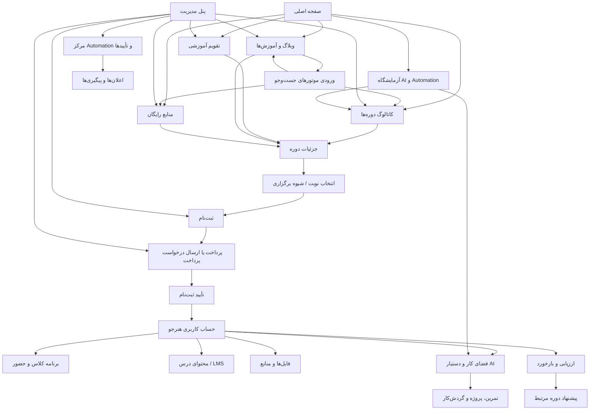
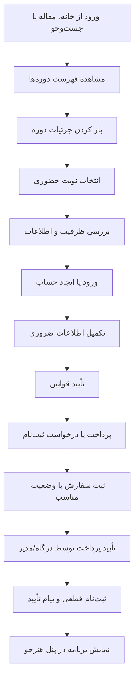
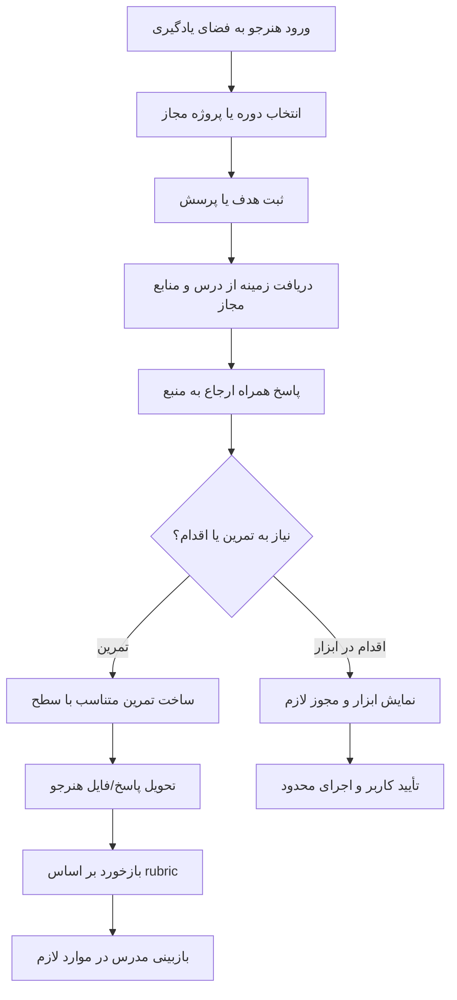
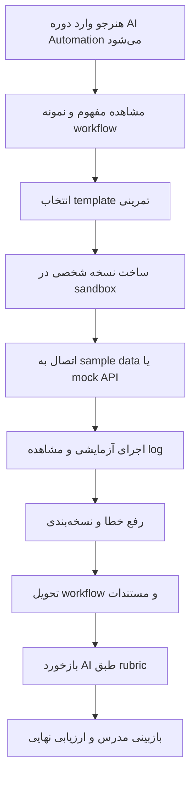
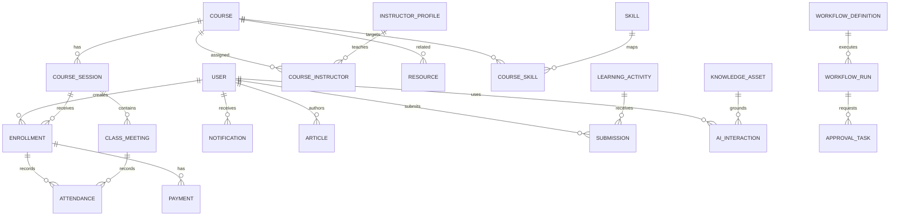

# HANDOFF.md — نقشه محصول و معماری اکوسیستم هوشمند آموزش، AI و Automation

> **نوع سند:** Product, AI Product & Technical Handoff برای عامل توسعه در Google AI Studio  
> **نسخه:** 2.0 — AI-native architecture  
> **تاریخ تهیه:** ۱۸ نوامبر ۲۰۲۶  
> **زبان اصلی محصول:** فارسی (RTL)  
> **وضعیت:** سند مبنای بررسی، اصلاح و تکمیل پروژه موجود؛ نه مجوز بازنویسی کورکورانه از صفر

---

> **یادداشت نسخه 2.0:** این نسخه، رویکرد محصول را از «وب‌سایت آموزشی کلاسیک» به «اکوسیستم AI-native آموزش و Automation» ارتقا می‌دهد. قابلیت‌های کلاسیک ثبت‌نام و مدیریت حفظ شده‌اند، اما AI، یادگیری پروژه‌محور، گردش‌کار و اتصال‌پذیری از ابتدا در نقشه محصول و معماری وارد شده‌اند.

## 0. دستور اصلی به عامل توسعه (ابتدا این بخش را اجرا کن)

تو نقش یک تیم کامل محصول را بر عهده داری: مدیر محصول، معمار اطلاعات، طراح UX/UI، توسعه‌دهنده ارشد Front-end و Back-end، متخصص پایگاه داده، امنیت، SEO و آزمون نرم‌افزار.

هدف، تبدیل پروژه فعلی به یک **اکوسیستم هوشمند یادگیری، آموزش معماری، AI و AI Automation** است؛ نه صرفاً یک وب‌سایت کلاسیک فروش دوره. سایت عمومی، ثبت‌نام و پرداخت همچنان لازم‌اند، اما هسته تجربه باید به یادگیری پروژه‌محور، دستیارهای هوشمند، گردش‌کارهای خودکار، فضای کار آموزشی و اتصال‌پذیری ابزارها گسترش یابد. مجموعه در درجه اول دوره‌های معماری و طراحی را ارائه می‌کند و هم‌زمان آموزش AI، AI Automation، طراحی گردش‌کار، Agentها و کاربردهای هوش مصنوعی در کار حرفه‌ای را به‌عنوان یک محور راهبردی توسعه می‌دهد.

### 0.1 مهم‌ترین قانون: قبل از تغییر، پروژه را بررسی کن

1. تمام فایل‌ها، پوشه‌ها، ساختار پروژه، وابستگی‌ها، صفحات، کامپوننت‌ها، مسیرها، استایل‌ها، فونت‌ها، تصاویر، تم و بخش‌هایی را که قبلاً ساخته شده‌اند بررسی کن.
2. تشخیص بده پروژه در حال حاضر بر چه بستری ساخته شده است: React، Next.js، Vite، WordPress، Elementor، یک قالب HTML یا معماری دیگری. **از روی حدس تکنولوژی انتخاب نکن.**
3. تمام قابلیت‌ها و طراحی‌های مفید موجود را فهرست کن و نگه دار. ابتدا پروژه را به Git commit یا یک نسخه پشتیبان قابل بازگشت تبدیل کن، مشروط بر اینکه ابزار و دسترسی لازم وجود داشته باشد.
4. پیش از تغییرات گسترده، یک گزارش کوتاه از این موارد ارائه کن:
   - ساختار و فناوری‌های فعلی
   - صفحات و کامپوننت‌های موجود
   - بخش‌های سالم و قابل استفاده مجدد
   - مشکلات طراحی، تجربه کاربری، عملکرد و کدنویسی
   - قابلیت‌های ناقص، نمایشی یا بدون عملکرد واقعی
   - تغییرات ضروری و خطرهای احتمالی
5. سپس بر اساس همین سند، پروژه را **در همان ساختار و فناوری موجود تا حد امکان** اصلاح کن. بازنویسی کامل، تعویض فریم‌ورک، حذف قالب یا مهاجرت CMS فقط وقتی مجاز است که دلیل فنی روشن داشته باشد و مزیت آن از هزینه و ریسک مهاجرت بیشتر باشد.
6. اگر پروژه WordPress است، قالب اصلی و Child Theme، Elementor، تنظیمات فعلی و محتوای موجود را بی‌دلیل حذف نکن. اگر پروژه یک اپلیکیشن React یا Next.js است، همان معماری را به شکل اصولی تکمیل کن. اگر بخشی از پروژه از Chamilo استفاده می‌کند، آن را بدون بررسی و برنامه مهاجرت جایگزین نکن.
7. هیچ صفحه، دکمه، فرم یا لینکی را صرفاً برای زیبا شدن اضافه نکن؛ هر جزء باید عملکرد مشخص و مقصد روشن داشته باشد.
8. اطلاعات، دوره‌ها، استادان، قیمت‌ها، تاریخ‌ها، نظرات هنرجویان، آمار و گواهینامه‌های ساختگی تولید نکن. برای داده‌های ناموجود از محتوای نمونه با برچسب واضح «نمونه / نیازمند تکمیل» استفاده کن و آن‌ها را به‌عنوان واقعیت منتشر نکن.
9. هیچ کلید API، رمز عبور، توکن، اطلاعات پرداخت یا Secret را در کد سمت کاربر، Git یا فایل‌های عمومی قرار نده.
10. در پایان هر مرحله، تغییرات را اجرا و تست کن. فقط تولید کد کافی نیست؛ باید مسیر واقعی کاربر را از ابتدا تا انتها آزمایش کنی.

### 0.2 روش اجرا

کار را در مراحل کوچک و قابل بازبینی انجام بده:

- مرحله A: ممیزی پروژه و گزارش وضعیت؛ بدون تغییر مخرب.
- مرحله B: طراحی نقشه مسیرها، معماری اطلاعات و مدل داده متناسب با کد موجود.
- مرحله C: اصلاح چارچوب بصری، هدر، فوتر، ناوبری و صفحات اصلی.
- مرحله D: راه‌اندازی کاتالوگ دوره، صفحه جزئیات، تقویم و ثبت‌نام.
- مرحله E: ساخت پنل مدیریت و اتصال پایگاه داده و احراز هویت واقعی.
- مرحله F: تکمیل وبلاگ، منابع، جست‌وجو و SEO.
- مرحله G: اتصال قابلیت‌های آموزش آنلاین، پرداخت، اعلان‌ها و LMS به‌صورت مرحله‌ای.
- مرحله H: ایجاد زیرساخت AI و Automation شامل AI Gateway، رویدادهای دامنه، اجرای گردش‌کارها، دستیار محدود و پایگاه دانش.
- مرحله I: آزمون کیفیت خروجی AI، امنیت ابزارها، هزینه/مصرف، حریم خصوصی و نظارت انسانی.
- مرحله J: بهینه‌سازی، مستندسازی، پشتیبان‌گیری و استقرار.

اگر اجرای تمام قابلیت‌ها در یک مرحله ممکن نیست، قابلیت‌ها را حذف یا شبیه‌سازی نکن. آن‌ها را مطابق اولویت‌های این سند پیاده‌سازی کن و موارد باقی‌مانده را با وضعیت دقیق «پیاده‌سازی نشده»، «نیازمند تنظیمات» یا «نیازمند سرویس خارجی» مشخص کن.

### 0.3 اصول تصمیم‌گیری در نبود اطلاعات

برای جلوگیری از توقف بی‌مورد، از پیش‌فرض‌های زیر استفاده کن و آن‌ها را در یک صفحه تنظیمات قابل تغییر نگه دار:

- نام برند: فعلاً «نام آکادمی / مجموعه»؛ نام نهایی، لوگو و دامنه باید قابل جایگزینی باشد. از ثبت قطعی نام «Neeleh Academy» یا هر نام دیگری بدون تأیید استفاده نکن.
- حوزه اصلی: آموزش معماری، طراحی، نرم‌افزارهای معماری و طراحی دیجیتال.
- زبان: فارسی و راست‌چین در نسخه اول؛ ساختار ترجمه‌پذیر برای افزودن انگلیسی در آینده.
- تقویم نمایشی: شمسی برای کاربر فارسی‌زبان؛ ذخیره تاریخ در پایگاه داده با قالب استاندارد و مستقل از نمایش.
- منطقه زمانی پیش‌فرض: `Asia/Tehran`؛ در پنل مدیریت قابل تغییر باشد.
- واحد پول نمایشی: تومان؛ واحد و ضریب تبدیل در تنظیمات قابل تغییر باشد. در محاسبات مالی، اعداد صحیح و دقیق استفاده کن و تبدیل ریال/تومان را در چند جای کد پراکنده نکن.
- شکل برگزاری دوره‌ها: حضوری، آنلاین زنده، ضبط‌شده و ترکیبی.
- محل برگزاری، زمان، قیمت، ظرفیت و اطلاعات مدرس تا زمانی که مالک سایت وارد نکرده، اطلاعات قطعی محسوب نمی‌شوند.
- راه ارتباطی و شبکه‌های اجتماعی فقط از تنظیمات سایت خوانده شوند؛ اطلاعات تماس ساختگی نساز.

---

# 1. تعریف محصول و راهبرد سایت

## 1.1 تعریف محصول

یک **اکوسیستم هوشمند آموزش و تولید مهارت** در حوزه معماری، طراحی، نرم‌افزارهای تخصصی، هوش مصنوعی و AI Automation. وب‌سایت عمومی درگاه معرفی و جذب است؛ محصول واقعی از سه فضای به‌هم‌پیوسته تشکیل می‌شود:

1. **Public Academy:** سایت عمومی برای کشف دوره‌ها، تقویم، مقالات، منابع، ثبت‌نام و اعتمادسازی.
2. **Learning Workspace:** محیط شخصی یادگیرنده برای دوره‌ها، پروژه‌ها، تمرین‌ها، منابع، بازخورد و دستیار آموزشی مبتنی بر محتوای معتبر.
3. **Automation & AI Operations:** لایه هوشمند پشت صحنه برای مدیریت گردش‌کارهای آموزشی، پیگیری هنرجویان، تولید و بازبینی محتوا، پشتیبانی و اتصال ابزارها.

کاربر باید بتواند در این اکوسیستم:

1. دوره مناسب خود را پیدا و مقایسه کند.
2. تفاوت دوره حضوری، آنلاین زنده و ضبط‌شده را بفهمد.
3. زمان‌بندی، ظرفیت، پیش‌نیاز، سرفصل و هزینه را ببیند.
4. بدون تماس تلفنی اجباری، درخواست ثبت‌نام یا خرید خود را ثبت کند.
5. وضعیت ثبت‌نام، پرداخت، کلاس‌ها و منابع آموزشی خود را در حساب کاربری پیگیری کند.
6. در صورت برگزاری دوره آنلاین، از محل مشخص و امن به کلاس دسترسی پیدا کند.
7. مقاله، آموزش رایگان، فایل و منابع مرتبط را جست‌وجو و مطالعه کند.
8. از طریق فرم‌ها و دستیارهای هوشمند با مجموعه ارتباط بگیرد.
9. در مسیر یادگیری از دستیار AI کمک بگیرد؛ پاسخ‌ها باید تا حد امکان متکی به سرفصل، جزوه، فایل و منابع تأییدشده همان دوره باشند.
10. تمرین، پروژه و خروجی قابل ارائه بسازد و بازخورد مرحله‌ای دریافت کند.
11. از طریق مسیرهای یادگیری مبتنی بر مهارت، دوره مناسب بعدی را پیدا کند.
12. در صورت دسترسی، از ابزارها و گردش‌کارهای AI Automation برای انجام تمرین‌های واقعی استفاده کند.

سایت نباید فقط ویترین دوره‌ها باشد. مسیر کاربر باید از **کشف مسئله → ارزیابی سطح و هدف → انتخاب مسیر یادگیری → ثبت‌نام → یادگیری همراه با AI → ساخت پروژه → ارزیابی و بازخورد → اثبات مهارت → یادگیری بعدی** پشتیبانی کند. مسیر خرید و ثبت‌نام فقط یکی از مسیرهای محصول است.

## 1.2 اولویت کسب‌وکار

اولویت نخست، ایجاد درآمد و جذب هنرجو از دوره‌های آموزشی قابل برگزاری است. پیشنهاد ساختار شروع:

- کلاس حضوری گروهی و خصوصی
- کارگاه‌های کوتاه‌مدت و تخصصی
- کلاس آنلاین زنده
- دوره‌های ضبط‌شده (پس از آماده شدن زیرساخت و محتوا)
- مشاوره و آموزش سازمانی، در صورت نیاز و تأیید مالک

**اولویت درآمدی نسخه اول:** دوره‌های حضوری و آنلاین زنده، زیرا سریع‌تر قابل عرضه و درآمدزایی هستند.

**اولویت معماری از روز اول:** آماده‌سازی زیرساخت AI و Automation، حتی اگر تمام قابلیت‌های هوشمند در نسخه اول فعال نشوند. زیرساخت باید شامل داده ساخت‌یافته، APIهای داخلی، رویدادهای دامنه، لایه اتصال سرویس‌ها، ثبت رضایت کاربر و AI Gateway قابل تعویض باشد.

این دو اولویت متناقض نیستند: ابتدا فروش و اجرای دوره‌های واقعی را عملیاتی کن، اما چنان طراحی کن که یادگیری هوشمند و اتوماسیون بعداً به سیستم الصاق نشوند؛ بلکه از ابتدا جایگاه معماری مشخص داشته باشند.

## 1.3 مخاطبان اصلی

- دانشجویان معماری و طراحی
- فارغ‌التحصیلان و معماران شاغل
- طراحان داخلی و طراحان صنعتی
- دفاتر معماری و تیم‌های مهندسی
- افراد علاقه‌مند به یادگیری نرم‌افزارهای طراحی و مدل‌سازی
- هنرجویان مبتدی تا پیشرفته

برای هر دوره سطح مخاطب، پیش‌نیاز و مهارت خروجی را شفاف نشان بده. از یک پیام عمومی مثل «مناسب همه» برای تمام دوره‌ها استفاده نکن.

## 1.4 دسته‌بندی محتوایی پیشنهادی

دسته‌بندی‌ها باید از پنل مدیریت قابل تغییر باشند. دسته‌های آغازین پیشنهادی:

- مبانی معماری و طراحی
- ترسیم و مستندسازی فنی: AutoCAD / GstarCAD و ابزارهای مشابه
- مدل‌سازی سه‌بعدی: SketchUp، Rhino و ابزارهای مرتبط
- طراحی پارامتریک و الگوریتمیک: Grasshopper، Computational Design
- BIM و مستندسازی: Revit، Archicad و گردش‌کار BIM
- رندر و ارائه: Enscape، V-Ray، Corona و ابزارهای ارائه
- هوش مصنوعی در معماری و طراحی
- AI Automation و طراحی گردش‌کارهای هوشمند
- ساخت Agentها، دستیارها و ابزارهای متصل به API
- RAG، پایگاه دانش و دستیارهای مبتنی بر اسناد
- یکپارچه‌سازی AI با نرم‌افزارها و فرایندهای دفتر معماری
- طراحی داخلی، نما و جزئیات اجرایی
- مرمت، باززنده‌سازی و معماری بومی
- کارگاه‌های پروژه‌محور و میان‌رشته‌ای

این فهرست صرفاً ساختار طبقه‌بندی است؛ وجود یک دسته به معنی آماده بودن دوره آن نیست.

## 1.5 ارزش پیشنهادی و لحن ارتباطی

پیام برند باید بر آموزش کاربردی، فهم عمیق، تجربه پروژه‌محور، همکاری انسان و AI، خودکارسازی مسئولانه و انتقال مهارت قابل استفاده در کار واقعی تمرکز کند. مجموعه باید فناوری را فقط موضوع تدریس نکند؛ در تجربه آموزشی و عملیات خودش نیز از آن به‌شکل مسئولانه استفاده کند.

پیشنهاد پیام اولیه برای صفحه اصلی (قابل ویرایش):

**«یادگیری طراحی، از شناخت ابزار تا ساختن راه‌حل»**

زیرعنوان پیشنهادی:

«دوره‌ها و کارگاه‌های تخصصی معماری و طراحی؛ حضوری، آنلاین و پروژه‌محور.»

از وعده‌های غیرقابل اثبات مثل «بهترین آموزش کشور»، «تضمین استخدام» یا «تضمین درآمد» استفاده نکن.


## 1.6 اصل راهبردی: AI-native، نه AI decoration

این محصول نباید یک سایت کلاسیک باشد که در گوشه آن یک پنجره چت اضافه شده است. AI باید در سه سطح طراحی شود:

- **AI as interface:** کاربر بتواند به زبان طبیعی جست‌وجو کند، هدفش را توضیح دهد، مسیر مناسب را بگیرد و در فضای کار خود با دستیار تعامل کند.
- **AI as learning method:** آموزش با تمرین، نقد، بازخورد، توضیح جایگزین، تولید نمونه و راهنمایی مرحله‌ای تقویت شود؛ نه اینکه AI صرفاً پاسخ آماده بدهد.
- **AI as operations engine:** فرایندهای تکراری و قابل پیش‌بینی مجموعه با قواعد و گردش‌کار خودکار شوند و در نقاط حساس تأیید انسانی داشته باشند.

**قاعده طراحی:** تجربه کلاسیک (صفحه دوره، فرم ثبت‌نام، تقویم و پنل) حذف نمی‌شود؛ بلکه به‌عنوان لایه تراکنشی قابل اعتماد باقی می‌ماند. AI روی آن لایه هوشمندی می‌سازد. عملیات مالی و وضعیت‌های رسمی باید deterministic و قابل حسابرسی بمانند؛ مدل زبانی مرجع حقیقت پرداخت، ظرفیت، ثبت‌نام یا نمره نهایی نیست.

## 1.7 پنج ستون محصول

1. **Learning Commerce:** کاتالوگ دوره، مشاوره، تقویم، ثبت‌نام، پرداخت و مدیریت نوبت.
2. **AI-assisted Learning:** دستیار آموزشی با دسترسی محدود به محتوای مجاز، ارزیابی تمرین و پیشنهاد مسیر یادگیری.
3. **AI Automation Academy:** آموزش عملی n8n یا ابزارهای مشابه، API، webhook، RAG، agent، MCP، طراحی فرایند و اتوماسیون دفتر معماری.
4. **Project & Tool Workspace:** فضای تحویل پروژه، فایل، تمرین و گردش‌کار؛ در آینده اتصال کنترل‌شده به Rhino/Grasshopper، CAD/BIM و ابزارهای دیگر.
5. **Knowledge & Content Engine:** وبلاگ، منابع، کتابخانه دانش نسخه‌بندی‌شده و محتوای چندرسانه‌ای که هم برای انسان قابل استفاده باشد و هم با مجوز مناسب در اختیار دستیارها قرار گیرد.

## 1.8 AI Automation باید دو نقش مستقل داشته باشد

**الف) موضوع آموزشی و محصول قابل فروش:** دوره‌ها و کارگاه‌های AI Automation، اتوماسیون بدون کدنویسی/کم‌کدنویسی، API و webhook، Agentها، RAG، اتصال مدل‌ها به ابزارها، MCP و پروژه‌های واقعی در معماری و کسب‌وکار.

**ب) زیرساخت عملکرد خود آکادمی:** فرایندهای پشت صحنه مانند ثبت سرنخ، مشاوره، ثبت‌نام، یادآوری، پیگیری غیبت، آماده‌سازی کلاس، جمع‌آوری بازخورد، گردش‌کار انتشار مقاله و گزارش‌گیری.

این دو را در مدل داده و رابط کاربری از هم تفکیک کن؛ هنرجو برای یادگیری Automation محیط آزمایش می‌خواهد، اما مدیر برای اداره سایت داشبورد کنترل و تأیید گردش‌کارها نیاز دارد.

### مسیر آموزشی پیشنهادی AI Automation

این مسیر را به‌عنوان یک نقشه مهارتی قابل گسترش طراحی کن، نه وعده عرضه تمام دوره‌ها در روز اول:

1. **Automation Literacy:** تحلیل فرایند، تشخیص کار تکراری، trigger، action، condition و طراحی workflow.
2. **No-code / Low-code Automation:** ساخت گردش‌کار عملی با ابزاری مانند n8n یا گزینه منتخب؛ مدیریت credential و خطا.
3. **API & Webhooks:** HTTP، JSON، REST API، webhook، احراز هویت، rate limit و اتصال سرویس‌ها.
4. **LLM in Workflows:** promptهای ساخت‌یافته، خروجی JSON، tool/function calling، طبقه‌بندی، استخراج و خلاصه‌سازی.
5. **Knowledge & RAG:** آماده‌سازی اسناد، chunking، metadata، embedding، retrieval، ارجاع منبع و کنترل دسترسی.
6. **Agents & Human Approval:** طراحی Agent برای هدف مشخص، ابزارهای محدود، مدیریت state، توقف، تأیید انسانی و ثبت رویداد.
7. **Interoperability:** آشنایی و تمرین MCP؛ بررسی A2A فقط در سناریوهای چند-Agent واقعی.
8. **Automation for Architecture:** گردش‌کارهای واقعی در دفتر معماری؛ مدیریت فایل و brief، تولید گزارش، مستندسازی، پردازش داده و اتصال کنترل‌شده به Rhino/Grasshopper و CAD/BIM.
9. **Evaluation & Operations:** تست، امنیت، مشاهده‌پذیری، هزینه، versioning، نگهداری و بهبود workflow.

هر مرحله باید با یک پروژه قابل نمایش تمام شود. خروجی هنرجو می‌تواند workflow export، مستندات، ویدئوی اجرای آزمایشی، نمونه‌داده و گزارش محدودیت/امنیت باشد.

## 1.9 دستیارهای محصول (AI Assistants)

دستیارها را بر اساس وظیفه طراحی کن، نه با یک «چت‌بات همه‌کاره» مبهم. در نسخه‌های بعدی امکان استفاده از یک رابط چت واحد با مهارت‌ها/ابزارهای محدود فراهم باشد:

- **Course Guide:** پاسخ به سؤال درباره دوره‌ها، سطح، پیش‌نیاز، زمان و شیوه برگزاری؛ فقط با داده زنده و معتبر دوره‌ها.
- **Learning Tutor:** توضیح درس، پاسخ مبتنی بر جزوه، ساخت تمرین، راهنمایی مرحله‌ای و ارجاع به درس/منبع مرتبط.
- **Project Critic:** ارائه بازخورد ساختاریافته به پروژه هنرجو با rubric تعریف‌شده توسط مدرس؛ هرگز وانمود نکند داوری نهایی مدرس است.
- **Automation Coach:** راهنمایی طراحی workflow، توضیح nodeها، APIها، webhookها و اشکال‌زدایی؛ اجرای واقعی فقط در sandbox و با مجوز.
- **Instructor Assistant:** کمک به تهیه تمرین، rubric، طرح جلسه، نمونه سؤال و خلاصه عملکرد کلاس؛ مدرس مسئول بازبینی و انتشار است.
- **Admin Operations Assistant:** جست‌وجوی اطلاعات و آماده‌سازی عملیات مجاز در پنل مدیر؛ عملیات حساس نیازمند تأیید صریح مدیر.
- **Content Research Assistant:** کمک به طرح مقاله، ساختاردهی منابع و تهیه پیش‌نویس؛ انتشار عمومی فقط پس از بازبینی انسانی.

دستیارها باید هویت، دامنه داده، مجوز ابزارها و محدودیت‌های خود را بشناسند. اگر پاسخ در منبع معتبر وجود ندارد، باید عدم اطمینان را اعلام کند و مسیر تماس/ارجاع به مدرس را نشان دهد.

## 1.10 الگوی آموزشی آینده‌نگر

هر دوره از «فهرست سرفصل» فراتر برود و به مجموعه‌ای ساخت‌یافته از موارد زیر تبدیل شود:

- مهارت‌ها و شایستگی‌های هدف (skills/competencies)
- سطح ورود و پیش‌نیازها
- خروجی قابل مشاهده و معیار موفقیت
- جلسات و درس‌ها
- تمرین‌های مرحله‌ای
- پروژه نهایی و rubric ارزیابی
- منابع معتبر و نسخه نرم‌افزارها
- نقاط مجاز استفاده از AI و مواردی که باید مستقل انجام شوند
- سیاست اعلام استفاده از AI در تحویل پروژه
- دستیار یا workflow مرتبط، در صورت وجود

هدف این نیست که همه دوره‌ها با AI تدریس شوند؛ هدف این است که هرجا AI ارزش آموزشی ایجاد می‌کند، آگاهانه و قابل ارزیابی وارد شود.

## 1.11 طراحی برای تغییر فناوری بدون قفل‌شدن به فروشنده

- مدل AI، سرویس embedding، vector store، سرویس speech، ابزار Automation و LMS باید پشت adapter/interface قرار گیرند.
- هیچ منطق حیاتی کسب‌وکار نباید فقط داخل prompt یا وابسته به یک ارائه‌دهنده مدل باشد.
- تعویض مدل باید بدون بازنویسی صفحات و مدل داده ممکن باشد.
- برای هر قابلیت، fallback تعریف کن: پاسخ دستی/FAQ، فرم تماس، اجرای بدون AI یا توقف امن.
- قابلیت‌های AI را با feature flag روشن/خاموش کن و برای محیط development، staging و production تنظیمات مستقل داشته باش.
- ساختار داده و API را مستند کن و از استانداردهای باز در محل‌های مناسب استفاده کن؛ استفاده از پروتکل جدید به‌تنهایی هدف نیست.

## 1.12 اصول موفقیت و محدودیت

موفقیت سایت با تعداد چت‌بات‌ها یا agentها سنجیده نمی‌شود. معیار، کاهش اصطکاک ثبت‌نام، افزایش کیفیت یادگیری، کاهش کار تکراری، تکمیل پروژه و رضایت واقعی هنرجو است. قابلیت AI که هزینه، پیچیدگی، خطا یا ریسک حریم خصوصی بیشتری از ارزشش ایجاد کند، نباید فعال شود.

---

# 2. معماری اطلاعات و نقشه کامل سایت (Sitemap)

## 2.1 ساختار ناوبری اصلی

منوی دسکتاپ پیشنهادی:

1. خانه
2. دوره‌ها
3. تقویم آموزشی
4. آموزش‌ها و مقالات
5. منابع و کتابخانه دانش
6. آزمایشگاه AI و Automation
7. درباره مجموعه
8. تماس با ما
9. ورود / فضای یادگیری

در موبایل، منو باید به شکل ساده و قابل دسترس باشد. دکمه اصلی CTA در هدر: **«مشاهده دوره‌ها»** یا **«مشاوره آموزشی»**؛ یک اقدام اصلی را برجسته کن، نه چندین دکمه هم‌رنگ و رقیب.

## 2.2 نقشه مسیرها

مسیرها با توجه به فناوری موجود قابل انطباق هستند. ساختار معنایی آن‌ها حفظ شود:

```text
/
├── /courses                         فهرست همه دوره‌ها
│   ├── /courses/:slug               صفحه اختصاصی هر دوره
│   └── /categories/:slug            صفحه دسته‌بندی دوره‌ها
├── /calendar                        تقویم و برنامه دوره‌ها
├── /training-formats                 شیوه‌های برگزاری
│   ├── /training-formats/in-person   آموزش حضوری
│   ├── /training-formats/live        آموزش آنلاین زنده
│   ├── /training-formats/recorded    دوره ضبط‌شده
│   └── /training-formats/hybrid      آموزش ترکیبی
├── /instructors                      معرفی مدرسان (در صورت نیاز)
│   └── /instructors/:slug            پروفایل مدرس
├── /blog                             فهرست مقالات
│   ├── /blog/:slug                   صفحه مقاله
│   └── /blog/category/:slug          دسته‌بندی مقالات
├── /resources                        کتابخانه منابع و فایل‌ها
│   └── /resources/:slug              صفحه هر منبع
├── /ai-lab                           معرفی آزمایشگاه AI و Automation
│   ├── /ai-lab/automation            دوره‌ها و پروژه‌های AI Automation
│   ├── /ai-lab/agents                آموزش Agent و دستیارها
│   ├── /ai-lab/rag                   آموزش پایگاه دانش و RAG
│   └── /ai-lab/projects              نمونه پروژه‌ها و گردش‌کارهای آموزشی
├── /about                            درباره مجموعه و رویکرد آموزشی
├── /faq                              پرسش‌های متداول
├── /contact                          تماس و درخواست مشاوره
├── /search                           جست‌وجوی سراسری
├── /login                            ورود
├── /register                         ثبت‌نام حساب کاربری
├── /forgot-password                  بازیابی رمز عبور
├── /verify                           تأیید حساب / ایمیل، در صورت فعال بودن
├── /checkout/:registrationId         تکمیل ثبت‌نام و پرداخت
├── /registration/:id                 وضعیت ثبت‌نام
├── /workspace                        محیط یادگیری و کار شخصی (نیازمند ورود)
│   ├── /workspace/assistant           دستیار آموزشی با سطح دسترسی مشخص
│   ├── /workspace/projects            پروژه‌ها و تمرین‌ها
│   ├── /workspace/submissions         تحویل‌ها و بازخوردها
│   └── /workspace/automations         محیط تمرین workflow در صورت فعال بودن
├── /dashboard                        پنل هنرجو (می‌تواند با /workspace ادغام شود)
│   ├── /dashboard/overview           نمای کلی
│   ├── /dashboard/my-courses         دوره‌های من
│   ├── /dashboard/schedule           برنامه کلاس‌ها
│   ├── /dashboard/registrations      ثبت‌نام‌ها
│   ├── /dashboard/payments           پرداخت‌ها و رسیدها
│   ├── /dashboard/resources          منابع و فایل‌ها
│   ├── /dashboard/progress           پیشرفت یادگیری (برای دوره‌های پشتیبانی‌شده)
│   ├── /dashboard/certificates       گواهی‌ها، در صورت فعال بودن
│   ├── /dashboard/support            درخواست پشتیبانی
│   └── /dashboard/profile            مشخصات و تنظیمات حساب
├── /instructor                       پنل مدرس، در صورت فعال شدن
├── /admin                            پنل مدیریت
│   ├── /admin/dashboard              آمار و کارهای مهم
│   ├── /admin/courses                مدیریت دوره‌ها
│   ├── /admin/sessions               مدیریت نوبت‌ها و کلاس‌ها
│   ├── /admin/enrollments            مدیریت ثبت‌نام‌ها
│   ├── /admin/students               مدیریت هنرجویان
│   ├── /admin/instructors            مدیریت مدرسان
│   ├── /admin/payments               مدیریت پرداخت‌ها
│   ├── /admin/attendance             حضور و غیاب
│   ├── /admin/content                مدیریت صفحات و منوها
│   ├── /admin/blog                   مدیریت مقالات
│   ├── /admin/resources              مدیریت منابع
│   ├── /admin/messages               پیام‌ها و درخواست‌ها
│   ├── /admin/reports                گزارش‌ها
│   ├── /admin/automation             مرکز گردش‌کارها و اجرای خودکار
│   ├── /admin/automation/runs        تاریخچه اجرا و خطاها
│   ├── /admin/approvals              صف تأیید عملیات انسانی
│   ├── /admin/ai                     دستیارها، مدل‌ها، دانش و مصرف AI
│   ├── /admin/integrations           اتصال‌ها و مجوزهای سرویس‌ها
│   └── /admin/settings               تنظیمات سایت
├── /privacy                          حریم خصوصی
├── /terms                            شرایط استفاده
├── /refund-policy                    قوانین لغو و استرداد
├── /education-policy                 قوانین شرکت در دوره‌ها
└── /404                              صفحه پیدا نشد
```

**توجه:** مسیرهای AI Lab و Workspace باید به‌تدریج فعال شوند و تنها وقتی قابلیت واقعی دارند در منوی عمومی نمایش داده شوند. تمام مسیرها لازم نیست در نسخه اول صفحه مستقل داشته باشند. صفحات کلیدی نسخه اول باید کامل باشند؛ مسیرهای آینده می‌توانند تا زمان پیاده‌سازی از منو پنهان بمانند. مسیر خالی یا دکمه‌ای که به صفحه ناموجود می‌رود ممنوع است.

## 2.3 ارتباط میان بخش‌ها



## 2.4 پیوندهای محتوایی

- هر دوره باید به دسته‌بندی، مدرس، نوبت‌های برگزاری، مقالات مرتبط و منابع مرتبط وصل باشد.
- هر مقاله باید بتواند به یک یا چند دوره مرتبط لینک بدهد؛ این پیوند باید از پنل مدیریت تنظیم شود.
- هر منبع آموزشی باید موضوع، نرم‌افزار/مهارت مرتبط و در صورت لزوم دوره مرتبط داشته باشد.
- تقویم آموزشی باید از داده نوبت‌های دوره تولید شود؛ تاریخ‌ها را جداگانه و دستی در چند صفحه وارد نکن.
- ظرفیت باقی‌مانده باید از ظرفیت کل منهای ثبت‌نام‌های معتبر و تأییدشده محاسبه شود؛ عدد ظرفیت را در چند محل مستقل ذخیره نکن.
- حساب هنرجو باید صرفاً اطلاعات ثبت‌نام و محتوایی را نشان دهد که همان کاربر مجاز به دیدن آن است.
- هر قابلیت AI باید به منبع دانش، نقش کاربر، سطح دسترسی، وضعیت رضایت و نوع عملیات خود متصل باشد؛ AI نباید با یک جست‌وجوی عمومی به تمام داده‌های سایت دسترسی پیدا کند.

---

# 3. جزئیات صفحات عمومی

## 3.1 صفحه اصلی `/`

هدف: کاربر در چند ثانیه متوجه شود این مجموعه چه چیزی آموزش می‌دهد، دوره‌ها برای چه کسانی است و قدم بعدی چیست.

ترتیب پیشنهادی بخش‌ها:

1. **هدر و منوی اصلی:** لوگو، منو، ورود، دکمه CTA. در اسکرول، هدر می‌تواند sticky شود؛ ارتفاع آن مزاحم محتوای موبایل نباشد.
2. **Hero:** یک تیتر دقیق، زیرعنوان کوتاه و دو اقدام حداکثر: «مشاهده دوره‌ها» و «مشاوره آموزشی». تصویر باید با موضوع معماری و یادگیری هماهنگ و واقعی/معتبر باشد؛ از تصویرهای کلیشه‌ای نامرتبط استفاده نکن.
3. **دسترسی سریع به دسته‌ها:** چند دسته اصلی در قالب کارت‌های ساده.
4. **دوره‌های پیش‌رو:** دوره‌های منتشرشده‌ای که نوبت ثبت‌نام فعال دارند. وضعیت و شیوه برگزاری باید واضح باشد.
5. **تقویم نزدیک‌ترین کلاس‌ها:** تاریخ، ساعت، شیوه برگزاری و وضعیت ظرفیت.
6. **چرا این مجموعه؟** چند مزیت واقعی و قابل اثبات، نه شعارهای عمومی.
7. **مسیرهای یادگیری:** مثال‌هایی مانند «از مقدماتی تا مدل‌سازی پیشرفته» و «از طراحی دستی تا AI Automation» فقط در صورت تعریف واقعی مسیر.
8. **AI و Automation در عمل:** معرفی آزمایشگاه، نمونه گردش‌کار و دستیارهای آموزشی فعال؛ فقط قابلیت‌های قابل استفاده نمایش داده شوند.
8. **مقاله‌ها و آموزش‌های تازه:** 3 تا 4 محتوای منتخب.
9. **منابع رایگان:** فایل‌ها، چک‌لیست‌ها، آموزش‌های کوتاه یا نمونه تمرین.
10. **معرفی مدرس/مدرسان:** فقط پروفایل واقعی و تأییدشده.
11. **پرسش‌های متداول کوتاه:** لینک به صفحه FAQ.
12. **CTA پایانی:** مشاهده تقویم یا درخواست مشاوره.
13. **فوتر:** اطلاعات مجموعه، لینک‌های مهم، شبکه‌های اجتماعی واقعی، قوانین و راه‌های تماس.

قواعد صفحه اصلی:

- دوره‌های تمام‌شده یا ناموجود را به‌عنوان دوره قابل ثبت‌نام نمایش نده.
- تعداد کارت‌ها محدود و قابل کنترل باشد؛ صفحه اصلی نباید به کاتالوگ بی‌انتها تبدیل شود.
- محتوای صفحه از پنل مدیریت قابل ویرایش باشد.
- در اولین نمایش صفحه، اقدام اصلی و ماهیت آموزش مشخص باشد.

## 3.2 صفحه فهرست دوره‌ها `/courses`

امکانات:

- جست‌وجو بر اساس عنوان، نرم‌افزار، مهارت یا مدرس.
- فیلتر موضوع/دسته‌بندی.
- فیلتر سطح: مقدماتی، متوسط، پیشرفته.
- فیلتر شیوه برگزاری: حضوری، آنلاین زنده، ضبط‌شده، ترکیبی.
- فیلتر وضعیت: ثبت‌نام باز، به‌زودی، تکمیل ظرفیت، در حال برگزاری، پایان‌یافته.
- فیلتر زمان/ماه در صورت وجود تقویم داده‌شده.
- مرتب‌سازی: نزدیک‌ترین شروع، جدیدترین، مدت، قیمت (در صورت معنادار بودن).
- پاک‌کردن فیلترها و نمایش تعداد نتایج.
- صفحه‌بندی یا بارگذاری تدریجی؛ از بارگذاری یک‌باره حجم زیادی داده خودداری کن.

هر کارت دوره باید شامل این موارد باشد:

- تصویر شاخص استاندارد
- عنوان و خلاصه کوتاه
- دسته و سطح
- شیوه برگزاری
- مدت دوره
- تاریخ شروع نزدیک‌ترین نوبت، اگر ثبت شده باشد
- قیمت یا عبارت روشن «برای اطلاع از هزینه تماس بگیرید» فقط اگر واقعاً قیمت عمومی نیست
- وضعیت ظرفیت/ثبت‌نام
- دکمه «جزئیات دوره»

## 3.3 صفحه جزئیات دوره `/courses/:slug`

این صفحه مهم‌ترین صفحه تبدیل بازدیدکننده به هنرجو است. اطلاعات را به ترتیب تصمیم‌گیری کاربر نمایش بده:

1. عنوان، خلاصه ارزش دوره، تصویر/ویدئوی معرفی و دسته.
2. نشانگرهای اطلاعات سریع: سطح، مدت، شیوه برگزاری، زبان، پیش‌نیاز.
3. وضعیت ثبت‌نام و CTA واضح.
4. انتخاب نوبت برگزاری: تاریخ شروع و پایان، روزها، ساعت، ظرفیت، محل یا بستر آنلاین، قیمت و وضعیت.
5. معرفی مسئله‌ای که دوره حل می‌کند.
6. مهارت‌ها و خروجی قابل انتظار؛ به صورت دقیق و قابل سنجش.
7. این دوره برای چه کسانی مناسب است / مناسب نیست.
8. پیش‌نیازها و دانش لازم.
9. سرفصل‌ها به شکل فصل و جلسه؛ قابل باز و بسته شدن.
10. نرم‌افزارها و ابزارهای لازم، نسخه‌های پشتیبانی‌شده و الزامات سخت‌افزاری در صورت نیاز.
11. روش تدریس و تمرین/پروژه نهایی.
12. معرفی مدرس و سوابقی که تأیید شده‌اند.
13. شیوه ارائه فایل، پشتیبانی و دسترسی پس از پایان دوره.
14. قوانین غیبت، جابه‌جایی جلسه، لغو و استرداد.
15. FAQ مختص همان دوره.
16. مقالات و منابع مرتبط.
17. دوره‌های مشابه یا مرحله بعدی یادگیری.

قواعد مهم:

- انتخاب نوبت قبل از ثبت‌نام الزامی باشد، مگر دوره فقط یک نوبت فعال داشته باشد.
- اگر هیچ نوبت فعالی وجود ندارد، CTA به «اطلاع از نوبت بعدی» یا «ثبت درخواست برگزاری» تبدیل شود.
- اگر ظرفیت صفر است، امکان پرداخت/ثبت‌نام قطعی غیرفعال و در صورت تمایل فهرست انتظار فعال شود.
- اگر دوره ضبط‌شده است، به جای تاریخ شروع گروهی، وضعیت دسترسی، مدت دسترسی و نوع پشتیبانی نمایش داده شود.
- FAQ، قیمت و سرفصل‌ها از داده دوره بخوانند؛ محتوای تکراری و متناقض در صفحات مختلف نساز.

## 3.4 تقویم آموزشی `/calendar`

- نمایش ماهانه و فهرستی؛ در موبایل نمای فهرستی پیش‌فرض مناسب‌تر است.
- تاریخ شمسی در رابط فارسی و ذخیره استاندارد تاریخ در پایگاه داده.
- هر رویداد شامل نام دوره، مدرس، نوع برگزاری، تاریخ، ساعت، مدت، محل/لینک اطلاعات و وضعیت ثبت‌نام.
- فیلتر دسته، شیوه برگزاری و وضعیت.
- کلیک روی رویداد به صفحه همان دوره و نوبت مرتبط برسد.
- امکان افزودن به تقویم شخصی (ICS/Google Calendar) در مرحله بعد.
- نوبت‌های لغو‌شده یا گذشته با وضعیت درست نمایش داده شوند؛ حذف خاموش آن‌ها ممکن است سوابق هنرجو را مخدوش کند.

## 3.5 صفحه شیوه‌های برگزاری

### آموزش حضوری

- توضیح تجربه و ساختار کلاس
- محل دقیق فقط در صورت تأیید مالک
- ظرفیت، تجهیزات، ساعات، شرایط حضور
- راهنمای دسترسی/نقشه فقط وقتی آدرس واقعی وارد شده باشد

### آنلاین زنده

- توضیح پلتفرم برگزاری بدون تعهد به سرویس خاص پیش از انتخاب
- نیازمندی اینترنت و نرم‌افزار
- روش دریافت لینک کلاس
- سیاست ضبط جلسات و حریم خصوصی
- پشتیبانی فنی و روش جبران اختلال

### دوره ضبط‌شده

- نمونه درس/پیش‌نمایش در صورت وجود
- تعداد فصل و مدت محتوا
- مدت دسترسی
- شیوه پرسش و پاسخ و پشتیبانی
- سیاست دانلود فایل‌ها

### ترکیبی

- تفکیک دقیق جلسات حضوری و آنلاین
- مشخص کردن اینکه کدام بخش اجباری یا اختیاری است
- محل و زمان هر بخش

## 3.6 صفحه معرفی مدرس

اطلاعات قابل نمایش:

- نام و تصویر
- معرفی کوتاه تخصصی
- سوابق تحصیلی و حرفه‌ای تأییدشده
- حوزه‌های تخصصی
- دوره‌های فعال و مقالات منتشرشده
- نمونه کار یا پروژه فقط در صورت اجازه انتشار

اطلاعات شخصی غیرضروری، شماره خصوصی یا ادعاهای غیرقابل اثبات منتشر نشود.

## 3.7 وبلاگ `/blog`

وبلاگ نقش جذب ورودی از موتورهای جست‌وجو، آموزش رایگان و ساخت اعتبار تخصصی را دارد.

قابلیت‌ها:

- فهرست مقالات با تصویر، عنوان، خلاصه، نویسنده، تاریخ انتشار و دسته
- جست‌وجو و فیلتر دسته/برچسب
- صفحه‌بندی
- مقاله‌های منتخب و مرتبط
- امکان اشتراک‌گذاری با URL استاندارد
- صفحه مقاله با فهرست مطالب، زمان تقریبی مطالعه، تصاویر، کپشن، منابع و لینک‌های داخلی
- درج CTA مرتبط و غیرمزاحم در مقاله، مثلاً معرفی یک دوره مرتبط
- نویسنده و تاریخ به‌روزرسانی
- canonical، متادیتای SEO و Open Graph
- امکان پیش‌نویس، زمان‌بندی انتشار و بازبینی

ساختار پیشنهادی مقالات:

- آموزش نرم‌افزارها
- نکته‌ها و تکنیک‌های معماری
- طراحی پارامتریک و الگوریتمیک
- BIM و مستندسازی
- رندر و ارائه
- هوش مصنوعی و فناوری طراحی
- تاریخ، نظریه و نقد معماری
- مرمت و باززنده‌سازی
- تجربه پروژه و فرایند طراحی

قالب مقاله باید از نظر خوانایی مناسب متن بلند باشد: عرض ستون محدود، فاصله خطوط مناسب، تیترهای سلسله‌مراتبی، تصاویر بهینه، فهرست مطالب و لینک به منابع.

## 3.8 کتابخانه منابع `/resources`

انواع محتوا:

- فایل نمونه و تمرین
- قالب و چک‌لیست
- فایل CAD/BIM/مدل سه‌بعدی
- تعریف یا اسکریپت نمونه Grasshopper
- راهنمای PDF
- ویدئو یا آموزش کوتاه
- پیوند به ابزار و مستندات معتبر

هر منبع باید عنوان، شرح، نوع فایل، حجم، نسخه/نرم‌افزار مرتبط، سطح، مجوز استفاده و دوره مرتبط داشته باشد.

قواعد دانلود:

- دسترسی عمومی یا ویژه هنرجویان باید مشخص باشد.
- فایل خصوصی از مسیر عمومی قابل دریافت نباشد؛ از URL امضاشده یا کنترل دسترسی سرور استفاده شود.
- نوع و حجم فایل قبل از دانلود نمایش داده شود.
- فایل قابل دانلود باید از نظر بدافزار و نوع MIME بررسی شود.
- برای منابع عمومی، ثبت‌نام اجباری و بی‌دلیل ایجاد نکن. منابع ویژه می‌توانند پشت ورود کاربر باشند.

## 3.9 درباره، FAQ و تماس

**درباره:** فلسفه آموزشی، حوزه تخصصی، روش آموزش، سابقه واقعی، تیم و مسیر ارتباطی.

**FAQ:** پرسش‌ها بر اساس موضوع گروه‌بندی شوند: ثبت‌نام، پرداخت، دوره حضوری، کلاس آنلاین، فایل‌ها، پیش‌نیازها، لغو و پشتیبانی.

**تماس:** فرم کوتاه شامل نام، راه تماس، موضوع، متن پیام و رضایت از سیاست حریم خصوصی. موضوع درخواست قابل انتخاب باشد. فرم باید پیام موفقیت/خطا و شناسه درخواست بدهد. راه تماس مستقیم فقط با داده واقعی نمایش داده شود.

---

# 4. مسیرهای کلیدی کاربر (User Journeys)

## 4.1 ثبت‌نام در دوره حضوری



الزامات:

- اطلاعاتی که قبلاً وارد شده دوباره از کاربر درخواست نشود.
- ظرفیت در لحظه ثبت‌نام دوباره بررسی شود تا ثبت‌نام بیش از ظرفیت رخ ندهد.
- برای پرداخت ناموفق، وضعیت ثبت‌نام و تلاش پرداخت حفظ شود.
- ثبت‌نام بدون پرداخت فقط در حالت‌های تعریف‌شده مانند «نیازمند بررسی مدیر» مجاز باشد.
- کاربر رسید، کد پیگیری و وضعیت روشن دریافت کند.

## 4.2 ثبت‌نام آنلاین زنده

همان مسیر بالا با انتخاب نوبت آنلاین؛ پس از تأیید ثبت‌نام:

- لینک ورود به کلاس فقط برای هنرجوی مجاز نمایش داده شود.
- لینک در صفحه عمومی، HTML عمومی یا پاسخ API بدون احراز مجوز قرار نگیرد.
- منطقه زمانی در حساب کاربر و زمان محلی کلاس مشخص باشد.
- یادآوری کلاس قابل ارسال باشد.
- سیاست ضبط جلسه و شرایط انتشار ضبط‌شده به کاربر اعلام شود.

## 4.3 خرید دوره ضبط‌شده

- مشاهده جزئیات و پیش‌نمایش
- ثبت‌نام و پرداخت
- اعطای دسترسی به دوره
- مشاهده فصل‌ها و درس‌ها
- ذخیره پیشرفت
- دانلود فایل‌های مجاز
- پرسش و پاسخ یا پشتیبانی در صورت ارائه
- صدور گواهی فقط وقتی معیار و سازوکار واقعی تعریف شده باشد

## 4.4 درخواست مشاوره آموزشی

فرم کوتاه: نام، راه ارتباطی، موضوع علاقه، سطح تقریبی، شیوه ترجیحی و توضیح اختیاری. درخواست در پنل مدیریت ثبت شود و وضعیت‌هایی مانند جدید، در حال پیگیری، پاسخ داده‌شده و بسته‌شده داشته باشد.

## 4.5 مسیر محتوایی از مقاله به دوره

مقاله تخصصی → منابع مرتبط → دوره مرتبط → جزئیات دوره → ثبت‌نام. لینک‌ها باید مرتبط و طبیعی باشند؛ مقاله را به بنر تبلیغاتی تبدیل نکن.

## 4.6 مسیر دستیار یادگیری



الزامات: گفت‌وگو و فایل هنرجو فقط در دامنه مجاز ذخیره شود؛ منابع مورد استفاده در پاسخ نمایش داده شوند؛ مکالمه AI به‌تنهایی مدرک حضور، نمره نهایی، تکمیل دوره یا صدور گواهی محسوب نشود.

## 4.7 مسیر یادگیری و ساخت AI Automation



فضای تمرین باید شامل کتابخانه templateهای قابل کپی، راهنمای node/trigger، sample data، history اجرا و خطا، versioning و امکان export/import در صورت پشتیبانی ابزار منتخب باشد. در نسخه اول لازم نیست یک ویرایشگر بصری اختصاصی از صفر ساخته شود؛ می‌توان از ابزار workflow منتخب در یک محیط کنترل‌شده استفاده کرد و تجربه کاربری سایت را به آن متصل کرد.

هر هنرجو باید فضای تمرین جداگانه داشته باشد. credential واقعی سرویس شخصی نباید در دیتابیس مشترک یا workflow template عمومی ذخیره شود. اجرای workflow در ابتدا فقط با داده نمونه و سرویس‌های allowlist شده مجاز باشد. اتصال به حساب واقعی کاربر باید opt-in، دارای scope محدود و با روش امن OAuth/Secret storage باشد.

---

# 5. حساب کاربری هنرجو

## 5.1 نمای کلی داشبورد

پس از ورود، کاربر باید بدون جست‌وجو بداند:

- چه دوره‌هایی ثبت‌نام کرده است؟
- ثبت‌نام هر دوره چه وضعیتی دارد؟
- کلاس بعدی چه روز و ساعتی برگزار می‌شود؟
- آیا پرداخت یا مدرکی نیاز به اقدام دارد؟
- به چه فایل‌ها یا درس‌هایی دسترسی دارد؟
- پیام یا اعلان جدیدی وجود دارد؟

## 5.2 بخش‌های داشبورد

- **دوره‌های من:** کارت دوره، وضعیت، مدرس، شیوه و لینک جزئیات.
- **برنامه کلاس‌ها:** جلسات آتی و گذشته، تاریخ/ساعت، وضعیت لغو یا تغییر.
- **ثبت‌نام‌ها:** شماره پیگیری، تاریخ، دوره، نوبت و وضعیت.
- **پرداخت‌ها:** مبلغ، تاریخ، روش، شناسه تراکنش و رسید.
- **منابع:** فایل‌های مجاز دوره.
- **پیشرفت:** فقط در دوره‌هایی که محتوای درس و ثبت پیشرفت پیاده‌سازی شده.
- **گواهی‌ها:** فقط گواهی‌های معتبر صادرشده.
- **پشتیبانی:** ثبت و پیگیری درخواست.
- **پروفایل:** نام، ایمیل/شماره تماس، تنظیمات اعلان و تغییر رمز.
- **دستیار یادگیری:** دسترسی به Tutor برای دوره‌های فعال و منابع همان دوره.
- **پروژه‌ها و تمرین‌ها:** brief، فایل‌های تحویل‌شده، نسخه‌ها، بازخورد AI و مدرس، وضعیت اصلاح.
- **آزمایشگاه Automation:** templateهای تمرینی، sandbox یا لینک محیط workflow مجاز، run history، log، export و تحویل پروژه؛ فقط برای دوره‌های پشتیبانی‌شده.
- **مهارت‌ها و مسیر یادگیری:** مهارت‌های هدف، تمرین‌های تکمیل‌شده و پیشنهاد گام بعدی؛ بدون رتبه‌بندی غیرشفاف یا ادعای تسلط قطعی.

## 5.3 وضعیت‌های ثبت‌نام

وضعیت‌ها باید تعریف یکنواخت و قابل فهم داشته باشند:

- `draft`: پیش‌نویس داخلی، برای کاربر قابل مشاهده نیست.
- `pending`: در انتظار پرداخت یا تکمیل اطلاعات.
- `under_review`: نیازمند بررسی مدیر.
- `confirmed`: قطعی و تأییدشده.
- `waitlisted`: فهرست انتظار.
- `cancelled`: لغو شده.
- `rejected`: رد شده.
- `completed`: دوره/ثبت‌نام تکمیل شده.
- `refunded`: وجه مسترد شده، در صورت پشتیبانی مالی.

تغییر وضعیت باید ثبت رویداد داشته باشد: چه کسی، چه زمانی و از چه وضعیتی به چه وضعیتی تغییر داده است.

---

# 6. پنل مدیریت

پنل باید برای یک مجموعه کوچک هم ساده باشد و در عین حال امکان رشد داشته باشد. ظاهر آن می‌تواند از رابط عمومی جدا باشد، اما باید از همان هویت بصری و اجزای پایه پیروی کند.

## 6.1 داشبورد مدیر

نمایش:

- ثبت‌نام‌های جدید در بازه انتخابی
- ثبت‌نام‌های در انتظار اقدام
- دوره‌های فعال و نزدیک به شروع
- دوره‌های تکمیل ظرفیت
- درخواست‌های مشاوره و پیام‌های جدید
- پرداخت‌های نیازمند بررسی
- میانبر ایجاد دوره، نوبت جدید و مقاله جدید

آمار فقط بر اساس داده واقعی پایگاه داده باشد. در نبود داده، حالت خالی مناسب نمایش بده؛ عدد نمایشی نساز.

## 6.2 مدیریت دوره‌ها

امکانات CRUD کامل:

- ایجاد، ویرایش، پیش‌نویس، انتشار، بایگانی
- عنوان، slug، خلاصه، متن کامل و تصویر
- دسته، سطح و برچسب
- نوع برگزاری
- اهداف و خروجی یادگیری
- مخاطب و پیش‌نیاز
- سرفصل‌های مرتب‌شده
- ابزارها و نسخه‌ها
- مدرس یا مدرسان
- منابع و مقالات مرتبط
- FAQ اختصاصی
- SEO title، description، تصویر اجتماعی
- وضعیت انتشار و زمان انتشار

## 6.3 مدیریت نوبت‌ها و کلاس‌ها

یک «دوره» با یک یا چند «نوبت برگزاری» مرتبط است. هر نوبت می‌تواند تاریخ، ساعت، مدرس، شیوه، ظرفیت، قیمت و مکان خاص خودش را داشته باشد.

فیلدهای نوبت:

- شناسه و دوره مرتبط
- عنوان اختیاری نوبت
- شیوه برگزاری
- تاریخ و ساعت شروع/پایان
- منطقه زمانی
- الگوی تکرار یا جلسات مجزا
- ظرفیت کل
- حداقل تعداد تشکیل کلاس، در صورت نیاز
- قیمت و تخفیف معتبر
- محل یا بستر آنلاین
- وضعیت: پیش‌نویس، برنامه‌ریزی‌شده، ثبت‌نام باز، تکمیل ظرفیت، در حال برگزاری، پایان‌یافته، لغو‌شده
- تاریخ پایان ثبت‌نام

برای کلاس چندجلسه‌ای، جدول جلسات جداگانه داشته باش. یک رشته متن بلند برای تمام زمان‌ها ذخیره نکن.

## 6.4 مدیریت ثبت‌نام و هنرجویان

- جست‌وجو و فیلتر
- مشاهده جزئیات ثبت‌نام
- تأیید، رد، لغو و انتقال به نوبت دیگر با ثبت تاریخچه
- افزودن هنرجو توسط مدیر با ثبت منبع ورود
- خروجی CSV محدود به نقش مجاز
- مشاهده سوابق هر هنرجو
- ارسال پیام یا اعلان مبتنی بر رویداد

## 6.5 پرداخت‌ها

نسخه اول می‌تواند دو شیوه داشته باشد:

1. درگاه آنلاین، پس از انتخاب و پیکربندی ارائه‌دهنده واقعی.
2. پرداخت دستی/واریز و ارسال رسید، با وضعیت «در انتظار بررسی مدیر».

قواعد امنیتی و مالی:

- اطلاعات کارت بانکی ذخیره نشود.
- تأیید پرداخت در سمت سرور و با اعتبارسنجی پاسخ ارائه‌دهنده انجام شود.
- بازگشت مرورگر از صفحه درگاه به‌تنهایی دلیل پرداخت موفق نیست.
- callback/webhook باید idempotent باشد؛ تکرار callback نباید سفارش را دوبار ثبت یا دوبار تأیید کند.
- مبلغ، واحد پول، شناسه سفارش و شناسه تراکنش ثبت شوند.
- اطلاعات حساس در گزارش خطاها نوشته نشود.
- کلیدهای درگاه فقط در تنظیمات امن سرور نگهداری شوند.
- اگر درگاه هنوز مشخص نیست، لایه پرداخت به‌صورت adapter طراحی شود؛ درگاه جعلی یا پرداخت نمایشی نساز.

## 6.6 حضور و غیاب

- ثبت جلسه و فهرست شرکت‌کنندگان تأییدشده
- وضعیت حاضر، غایب، تأخیر، موجه یا لغو جلسه
- ثبت‌کننده و زمان ثبت
- خروجی گزارش در صورت نیاز
- اطلاعات حضور فقط برای مدیر و مدرس مجاز قابل دسترسی باشد.

## 6.7 مدیریت وبلاگ و منابع

- ویرایشگر متن مناسب فارسی و RTL
- مدیریت تصویر شاخص و رسانه
- دسته، برچسب و نویسنده
- پیش‌نویس، انتشار و زمان‌بندی
- SEO و پیش‌نمایش اجتماعی
- لینک دوره‌ها و منابع مرتبط
- کنترل دسترسی فایل‌ها

## 6.8 مدیریت پیام‌ها و درخواست‌ها

هر درخواست باید شناسه، تاریخ، موضوع، راه تماس، متن، وضعیت و مسئول پیگیری داشته باشد. وضعیت و یادداشت داخلی از اطلاعات قابل مشاهده برای کاربر جدا باشد.

## 6.9 مرکز Automation و AI (افزوده راهبردی)

این بخش باید مرکز کنترل باشد، نه یک صفحه چت. امکانات موردنیاز:

- فهرست workflowها با نام، هدف، trigger، وضعیت فعال/غیرفعال، مالک و سطح ریسک.
- مشاهده اجرای اخیر، زمان، نتیجه، خطا، retry و هزینه تخمینی سرویس‌های بیرونی.
- صف اقداماتی که تأیید انسانی می‌خواهند.
- مشاهده اتصال‌های فعال، scope مجوزها و تاریخ آخرین اتصال؛ Secret واقعی فقط در محیط امن مدیریت شود و هیچ‌وقت در رابط عادی نمایش داده نشود.
- کنترل روشن/خاموش کردن دستیارها و گردش‌کارها با feature flag.
- گزارش کیفیت پاسخ AI، بازخورد کاربران، نرخ ارجاع به انسان و نرخ خطا.
- امکان توقف سراسری (kill switch) برای workflow یا ابزار پرخطر.

در نسخه اول، فقط چند گردش‌کار ساده و کم‌ریسک عملیاتی شوند؛ داشبورد نمایشی نساز.

## 6.10 نقش‌ها و مجوزها

نقش‌های حداقلی:

- `super_admin`: همه دسترسی‌ها و تنظیمات حیاتی
- `admin`: مدیریت روزمره سایت و آموزش
- `content_editor`: صفحات، وبلاگ و منابع؛ بدون دسترسی به اطلاعات مالی غیرضروری
- `instructor`: دوره‌ها و هنرجویان تخصیص‌یافته، جلسات و حضور و غیاب
- `student`: فقط داده‌ها و محتوای خودش و دوره‌هایی که دسترسی دارد
- `automation_manager`: مدیریت workflowهای مجاز و مشاهده اجراها؛ بدون دسترسی خودکار به امور مالی حساس
- `ai_reviewer`: بازبینی خروجی‌های AI و محتوای پیشنهادی؛ بدون اختیار انتشار/عملیات حساس مگر مجوز جداگانه

مجوزها باید **در سرور/پایگاه داده** بررسی شوند، نه فقط با پنهان کردن دکمه در رابط کاربری. کاربر نباید با تغییر URL یا ارسال مستقیم درخواست بتواند به داده دیگران دسترسی پیدا کند.

---

# 7. مدل داده و ارتباط موجودیت‌ها

مدل زیر مفهومی است و باید با فناوری فعلی پروژه تطبیق داده شود. نام فیلدها می‌تواند تغییر کند، اما روابط و قواعد کسب‌وکار حفظ شوند.

## 7.1 موجودیت‌های اصلی

### User

- `id`
- `full_name`
- `email` (unique در صورت استفاده)
- `phone` (unique در صورت سیاست ثبت‌نام)
- `password_hash` فقط اگر احراز هویت بومی استفاده شود؛ هرگز رمز خام
- `role`
- `status`
- `email_verified_at` / `phone_verified_at` در صورت پیاده‌سازی
- `created_at`, `updated_at`

### InstructorProfile

- `id`, `user_id` در صورت داشتن حساب
- `display_name`
- `bio`
- `avatar`
- `expertise[]`
- `verified_credentials[]`
- `public_links[]`
- `published`

### Course

- `id`, `title`, `slug`, `short_description`, `description`
- `category_id`
- `level`
- `formats[]`
- `learning_outcomes[]`
- `audience`
- `prerequisites[]`
- `syllabus[]` با ترتیب و توضیح
- `required_tools[]`
- `duration_value`, `duration_unit`
- `language`
- `cover_image`, `gallery[]`, `intro_video`
- `status`: draft/published/archived
- `featured`
- `seo_title`, `seo_description`, `canonical_url`
- `created_at`, `updated_at`, `published_at`

### CourseInstructor

رابط چندبه‌چند میان دوره و مدرس:

- `course_id`
- `instructor_id`
- `display_order`
- `responsibility` (اختیاری)

### CourseSession / Cohort

- `id`, `course_id`
- `title`
- `format`
- `start_at`, `end_at`
- `timezone`
- `registration_deadline`
- `capacity`
- `price_amount`, `currency`
- `location_id` یا اطلاعات بستر آنلاین امن
- `status`
- `created_at`, `updated_at`

### ClassMeeting

- `id`, `session_id`
- `starts_at`, `ends_at`
- `meeting_type`
- `location_or_secure_link_reference`
- `status`
- `instructor_id`

### Enrollment

- `id`, `user_id`, `session_id`
- `registration_code`
- `status`
- `price_snapshot`, `currency_snapshot`
- `discount_snapshot` در صورت استفاده
- `created_at`, `confirmed_at`, `cancelled_at`
- `source` (وب‌سایت، مدیر، کمپین و غیره)

قیمت snapshot لازم است تا تغییر قیمت آینده، سوابق خرید قبلی را تغییر ندهد.

### Payment

- `id`, `enrollment_id`
- `provider`
- `provider_reference`
- `amount`, `currency`
- `status`: initiated/pending/succeeded/failed/refunded
- `method`
- `receipt_file_reference` (برای پرداخت دستی)
- `verified_by`, `verified_at`
- `created_at`, `updated_at`

### Attendance

- `id`, `meeting_id`, `enrollment_id`
- `status`
- `note`
- `recorded_by`, `recorded_at`

### Article

- `id`, `title`, `slug`, `excerpt`, `body`
- `cover_image`, `author_id`
- `category_id`, `tags[]`
- `status`, `published_at`, `updated_at`
- `seo_title`, `seo_description`, `canonical_url`
- `related_courses[]`, `related_resources[]`

### Resource

- `id`, `title`, `slug`, `description`
- `resource_type`, `file_reference`, `external_url`
- `file_size`, `mime_type`, `software_version`
- `access_level`
- `license_terms`
- `related_courses[]`, `category_id`
- `status`, `created_at`

### ContactRequest / SupportTicket

- `id`, `user_id` اختیاری
- `name`, `email`, `phone`, `topic`, `message`
- `status`, `assigned_to`, `internal_note`
- `created_at`, `updated_at`, `resolved_at`

### Notification

- `id`, `user_id`, `type`, `title`, `message`
- `channel`, `status`, `sent_at`, `read_at`
- `related_entity_type`, `related_entity_id`

### Skill / Competency

- `id`, `name`, `slug`, `description`, `parent_id` اختیاری
- `level_scale`, `domain`, `status`

### CourseSkill

- `course_id`, `skill_id`, `target_level`, `is_required`

### LearningActivity / Assignment

- `id`, `course_id`, `lesson_id` اختیاری, `title`, `instructions`
- `activity_type`, `rubric_id`, `due_at`, `visibility`, `status`

### Submission / Feedback

- `id`, `activity_id`, `user_id`, `file_references[]`, `text_content`, `version`
- `status`, `submitted_at`
- feedback: `source` (AI/instructor), `rubric_result`, `comments`, `reviewed_by`, `created_at`
- خروجی AI و بازخورد مدرس باید از هم مشخص باشند.

### KnowledgeAsset

- `id`, `title`, `source_type`, `source_reference`, `course_id` اختیاری
- `version`, `language`, `access_scope`, `approved_status`, `updated_at`
- `chunking_status`, `index_status`, `content_hash`
- فقط فایل‌ها و محتوای تأییدشده و مجاز می‌توانند وارد دانش مورد استفاده RAG شوند.

### AIInteraction

- `id`, `user_id`, `assistant_id`, `context_scope`, `provider_key`, `model_key`
- `input_reference` و `output_reference` با سیاست نگهداری محدود؛ از ذخیره غیرضروری اطلاعات شخصی خودداری کن
- `source_references[]`, `safety_status`, `feedback`, `latency_ms`, `usage_summary`, `created_at`
- chain-of-thought یا استدلال پنهان مدل ذخیره یا درخواست نشود؛ ثبت پاسخ، منابع، ابزارهای فراخوانی‌شده و خلاصه قابل حسابرسی کافی است.

### WorkflowDefinition / WorkflowRun

- Definition: `id`, `name`, `description`, `trigger_type`, `trigger_config`, `steps`, `risk_level`, `enabled`, `owner_id`, `version`
- Run: `id`, `workflow_id`, `status`, `trigger_event_id`, `started_at`, `finished_at`, `error_code`, `retry_count`, `cost_summary`
- secretها و credentialها خارج از Definition و فقط در secret manager نگهداری شوند.

### ApprovalTask

- `id`, `workflow_run_id`, `action_summary`, `requested_by_system`, `required_role`
- `status`, `approved_by`, `approved_at`, `rejected_reason`, `expires_at`

### IntegrationConnection / ToolRegistry

- نوع سرویس، نام، endpoint reference، مجوزهای scope، وضعیت، last_checked_at
- مشخصات ابزار: نام، شرح، schema ورودی/خروجی، طبقه‌بندی ریسک و permission policy
- token و Secret هرگز در داده عمومی یا فرانت‌اند قرار نگیرد.

### ConsentRecord / AIUsageLedger

- Consent: `user_id`, `purpose`, `policy_version`, `granted_at`, `revoked_at`
- Usage: `user_id` اختیاری, `feature`, `provider`, `model`, `input_units`, `output_units`, `estimated_cost`, `created_at`
- ثبت رضایت و مصرف باید متناسب، قابل گزارش و دارای سیاست نگهداری باشند.

### Setting / SiteConfig

- نام و لوگو، زبان، منطقه زمانی، واحد پول، اطلاعات تماس، لینک شبکه‌ها، تنظیمات SEO، قوانین ثبت‌نام، تنظیمات پیام و تنظیمات اتصال.

### AuditLog

- `id`, `actor_user_id`, `action`, `entity_type`, `entity_id`
- `before_state`, `after_state` به شکل امن و بدون اسرار
- `ip_hash` یا داده محدود مورد نیاز امنیتی، در صورت توجیه و با سیاست حریم خصوصی
- `created_at`

## 7.2 روابط اصلی



## 7.3 قواعد یکپارچگی داده

- هر کاربر در یک نوبت، مطابق سیاست ثبت‌نام، فقط یک ثبت‌نام فعال داشته باشد.
- ظرفیت با تراکنش یا عملیات اتمیک کنترل شود؛ دو نفر هم‌زمان نباید آخرین ظرفیت را تصاحب کنند.
- مبلغ ثبت‌نام در لحظه خرید snapshot شود.
- دوره بدون عنوان، slug یکتا و وضعیت انتشار معتبر منتشر نشود.
- نوبت ثبت‌نام باز باید تاریخ و ظرفیت منطقی داشته باشد.
- ثبت‌نام قطعی باید به پرداخت موفق یا تأیید دستی معتبر متصل باشد.
- حذف دوره‌ای که سابقه ثبت‌نام یا پرداخت دارد، ترجیحاً به بایگانی/غیرفعال‌سازی تبدیل شود.
- حذف کاربر نباید سوابق مالی و حسابرسی را بدون سیاست قانونی و فنی مشخص نابود کند.
- دسترسی AI به داده‌ها باید با همان مجوزهای backend کنترل شود؛ embedding یا vector store مسیر دورزدن مجوز نیست.
- هر Submission، Feedback و AIInteraction باید مالک، scope و سیاست نگهداری روشن داشته باشد.

---

# 8. انتخاب معماری فنی و اتصال سیستم آموزش

## 8.1 اصل معماری

وب‌سایت عمومی، مدیریت ثبت‌نام و سامانه مدیریت یادگیری از نظر مسئولیت تفکیک شوند، حتی اگر در نسخه اول در یک مخزن یا اپلیکیشن اجرا شوند.

**وب‌سایت عمومی:** صفحات، SEO، دوره‌ها، مقاله‌ها، منابع و جذب مخاطب.  
**سامانه عملیاتی:** کاربران، نوبت‌ها، ثبت‌نام، پرداخت، پیام‌ها، ظرفیت و حضور و غیاب.  
**LMS:** فصل‌ها، درس‌ها، محتوای آموزشی، پیشرفت، آزمون و گواهی؛ در صورت نیاز از Chamilo یا سامانه مناسب دیگری استفاده شود.

## 8.2 سازگاری با پروژه فعلی

- اگر پروژه WordPress است، ابتدا امکان استفاده از WordPress به‌عنوان CMS و یک افزونه آموزشی/سفارشی را بررسی کن. برای بخش‌های اختصاصی، افزونه یا سرویس جداگانه با API روشن بهتر از تغییر مستقیم فایل‌های قالب اصلی است.
- اگر پروژه یک اپلیکیشن اختصاصی است، از همان چارچوب فعلی استفاده کن و ساختار ماژولار بساز.
- اگر بخشی از سایت در Chamilo پیاده شده، آن را به‌عنوان سامانه آموزش بررسی کن. لازم نیست محتوای LMS در دیتابیس سایت بازنویسی شود.
- از ساخت هم‌زمان دو سیستم ثبت‌نام یا دو منبع حقیقت برای اطلاعات هنرجو جلوگیری کن.

## 8.3 رویکرد پیشنهادی برای Chamilo

Chamilo می‌تواند مسئول بخش یادگیری باشد و سایت مسئول معرفی، ثبت‌نام، پرداخت و ارتباط با هنرجو. پیش از اتصال، نسخه نصب‌شده، قابلیت‌های API، روش احراز هویت و محدودیت‌های واقعی همان نسخه را بررسی کن.

اتصال باید از طریق adapter/service مستقل باشد تا اگر بعداً LMS تغییر کرد، بخش دوره‌ها و ثبت‌نام سایت از هم نپاشد.

فازهای احتمالی اتصال:

1. ایجاد یا تطبیق حساب هنرجو در LMS پس از تأیید ثبت‌نام.
2. ثبت‌نام کاربر در دوره متناظر LMS.
3. انتقال شناسه‌های متناظر بین سایت و LMS.
4. ورود یکپارچه (SSO) فقط با روش استاندارد و امن و پس از بررسی مستندات نسخه واقعی.
5. نمایش لینک ورود به کلاس و درس در پنل هنرجو.
6. دریافت وضعیت پیشرفت یا تکمیل دوره فقط اگر API معتبر و قابل اتکا وجود داشته باشد.

هیچ endpoint یا روش احراز هویتی را حدس نزن. اگر API/SSO قابل استفاده نیست، ابتدا راهکار جایگزین امن و کم‌هزینه ارائه کن و محدودیت را شفاف بنویس.

## 8.4 Google AI Studio و فناوری‌های میزبانی

Google AI Studio Build Mode می‌تواند برای ساخت و توسعه یک اپلیکیشن full-stack، اتصال مخزن GitHub و استقرار روی Cloud Run به کار رود. مستندات جاری همچنین توضیح می‌دهد که کلید Gemini در محیط سمت سرور به‌عنوان Secret نگهداری می‌شود؛ بااین‌حال، این موضوع به معنی وجود خودکار دیتابیس پایدار، CRM، صف کار، LMS یا موتور Automation کامل نیست. مستندات Google اشاره می‌کند که اپلیکیشن‌های Build روی Cloud Run اجرا می‌شوند و می‌توانند به هر راهکار ذخیره‌سازی قابل دسترس از طریق شبکه متصل شوند؛ بنابراین انتخاب و پیکربندی دیتابیس و storage باید جداگانه انجام شود.

مراجع رسمی: [Build apps in Google AI Studio](https://ai.google.dev/gemini-api/docs/aistudio-build-mode)، [Deploying from Google AI Studio](https://ai.google.dev/gemini-api/docs/aistudio-deploying).

قواعد اجرایی:

- پروژه موجود را قبل از انتخاب backend یا database بررسی کن؛ صرفاً به دلیل اینکه AI Studio ساخت اپلیکیشن را ساده می‌کند، معماری فعلی را عوض نکن.
- Secret فقط سمت سرور باشد؛ در build نهایی و bundle فرانت‌اند نیز جست‌وجوی کلیدها/توکن‌ها و بررسی نشتی انجام شود.
- دیتابیس، storage، authentication و queue باید با توجه به نیاز واقعی و بودجه انتخاب شوند؛ از فرض گرفتن قابلیت رایگان یا اتصال خودکار خودداری کن.
- اگر Firebase انتخاب شد، Security Rules را صریح و حداقلی تعریف و آزمایش کن. صرف ورود با Google نقش مدیر ایجاد نمی‌کند.
- داده‌های مالی و خصوصی فقط از مسیر امن سمت سرور تغییر کنند و Collection یا فایل خصوصی عمومی نشود.
- محیط توسعه، staging و production از هم جدا باشند.
- اگر Gemini API به‌عنوان provider انتخاب شد، از مستندات و SDK فعلی استفاده کن؛ مستندات جاری Google در ژوئن ۲۰۲۶ Interactions API را رابط پیش‌فرض و توصیه‌شده برای توسعه جدید معرفی کرده است. این انتخاب باید داخل Gemini adapter بماند و به منطق کل محصول سرایت نکند.

مرجع API: [Gemini API documentation](https://ai.google.dev/gemini-api/docs). اگر از provider یا دیتابیس دیگری استفاده می‌شود، همین اصول امنیت، مجوز، storage و قابلیت جایگزینی برقرار است.

## 8.5 ساختار ماژولار پیشنهادی

ماژول‌های مستقل یا پوشه‌های مفهومی:

- `auth`
- `users`
- `courses`
- `sessions`
- `enrollments`
- `payments`
- `attendance`
- `content` (blog/pages)
- `resources`
- `notifications`
- `support`
- `admin`
- `integrations` (LMS, payment, email/SMS, calendar)
- `shared` (design system, validation, utilities)

نام و ساختار دقیق را مطابق چارچوب موجود انتخاب کن؛ این فهرست یک مرزبندی مسئولیت است، نه اجبار برای ایجاد پوشه‌های بی‌استفاده.


## 8.6 معماری AI-native و Automation

### اصل معماری

از ابتدا microservices پیچیده نساز. برای شروع، **Modular Monolith + Background Workers + Event-driven integrations** انتخاب عملی‌تری است، مگر پروژه فعلی الزام فنی دیگری داشته باشد. منطق اصلی کسب‌وکار باید مستقل از AI باشد و لایه هوشمندی به‌صورت adapter و سرویس‌های قابل تعویض اضافه شود.

### لایه‌ها

1. **Experience Layer:** سایت عمومی، پنل هنرجو، پنل مدرس، پنل مدیر و UI دستیارهای زمینه‌مند.
2. **Core Domain/API:** کاربران، دوره‌ها، جلسات، ثبت‌نام، پرداخت، محتوا، پیشرفت و مجوزها. این لایه منبع حقیقت است.
3. **Domain Events:** رخدادهایی مانند `lead.created`, `enrollment.requested`, `payment.confirmed`, `session.reminder_due`, `attendance.marked`, `submission.created`, `course.completed`.
4. **Workflow Orchestrator:** اجرای گردش‌کارهای چندمرحله‌ای، زمان‌بندی، retry، timeout، توقف و صف تأیید. می‌توان n8n یا گزینه مناسب دیگر را ارزیابی کرد؛ اما لایه کسب‌وکار نباید به شکل اختصاصی به آن وابسته شود.
5. **AI Gateway:** انتخاب مدل/ارائه‌دهنده، محدودیت مصرف، مدیریت prompt template، timeout، fallback، logging و ارزیابی. تماس مدل فقط سمت سرور انجام شود.
6. **Knowledge/RAG Layer:** دریافت منابع تأییدشده، استخراج متن، chunking، embedding، ذخیره برداری، metadata و فیلتر مجوز؛ پاسخ همراه ارجاع به منبع.
7. **Tool & Integration Layer:** APIهای داخلی، LMS، ایمیل/SMS، تقویم، درگاه پرداخت، ابزارهای طراحی و اتصال‌های استاندارد. ابزارها با allowlist و scope محدود ارائه شوند.
8. **Observability & Governance:** log قابل حسابرسی، خطا، هزینه، latency، وضعیت رضایت، نسخه prompt/model و ارزیابی کیفیت.

### مرز مهم میان AI و منطق قطعی

- AI می‌تواند پیام ثبت‌نام را خلاصه کند، اما وضعیت ثبت‌نام را فقط سرویس دامنه تغییر می‌دهد.
- AI می‌تواند پیشنهاد پرداخت/پیگیری تهیه کند، اما تأیید تراکنش فقط از درگاه معتبر یا مدیر مجاز انجام می‌شود.
- AI می‌تواند بازخورد اولیه طبق rubric بدهد، اما نمره نهایی و گواهی رسمی تابع قواعد مصوب و مسئول انسانی است.
- AI می‌تواند ظرفیت را توضیح دهد، اما عدد ظرفیت از پایگاه داده خوانده می‌شود.
- AI می‌تواند workflow طراحی کند، اما اجرای آن باید در sandbox، با دسترسی محدود و تأیید مناسب انجام شود.

### Event-driven workflow

هر عملیات مهم، پس از ثبت موفق در Core Domain، یک event پایدار منتشر کند. Worker یا orchestrator می‌تواند بر اساس آن گردش‌کار اجرا کند. از فراخوانی مستقیم مدل از داخل هر دکمه UI یا وابستگی عملیات تراکنشی به پاسخ طولانی مدل خودداری کن. برای رخدادها از الگوی قابل اطمینان مانند transactional outbox در صورت سازگاری با دیتابیس استفاده کن.

### جایگاه MCP و A2A

- **MCP** را به‌عنوان گزینه استاندارد اتصال کنترل‌شده مدل/Agent به منابع و ابزارها در نظر بگیر؛ ابزارهای سایت مانند جست‌وجوی دوره، مشاهده برنامه مجاز، دریافت منابع و ایجاد پیش‌نویس می‌توانند بعداً از طریق MCP adapter عرضه شوند.
- هر ابزار MCP باید schema دقیق، scope مجوز، محدودیت نرخ، طبقه‌بندی ریسک، log و امکان رد/تأیید انسانی داشته باشد.
- **A2A** فقط زمانی بررسی شود که واقعاً چند Agent مستقل نیاز به همکاری بین سامانه‌ای داشته باشند. برای نسخه اول، معماری چند-Agent یا پروتکل‌های پیچیده بدون نیاز واقعی نساز.
- مستندات رسمی MCP: https://github.com/modelcontextprotocol/modelcontextprotocol/tree/main/docs/specification/2026-07-28 و اصول امنیت/تأیید ابزارها. مستندات A2A: https://a2a-protocol.org/ و منابع رسمی Google Cloud.

### RAG و دانش سازمانی

- منابع مجاز: سرفصل مصوب، جزوه مدرس، FAQ، مقاله منتشرشده، راهنمای داخلی تأییدشده و مستندات مجاز نرم‌افزار.
- هر منبع باید مالک، نسخه، تاریخ، زبان، course scope، سطح دسترسی و وضعیت تأیید داشته باشد.
- فایل جدید تا قبل از بررسی نوع فایل، پاک‌سازی، استخراج و تأیید مدیر/مدرس وارد دانش فعال نشود.
- پاسخ Tutor باید source reference یا پیوند به فصل/صفحه/منبع بدهد.
- داده خصوصی یک هنرجو نباید در پاسخ به هنرجوی دیگر بازیابی شود.
- اسناد و متن بازیابی‌شده «داده» هستند، نه دستور سیستم؛ از prompt injection در فایل‌ها و صفحات وب دفاع کن.

## 8.7 گردش‌کارهای AI Automation پیشنهادی

این گردش‌کارها نمونه‌اند؛ هرکدام باید جداگانه با trigger، شرایط، اقدام، خطا و مالک مشخص پیاده‌سازی شود.

### گردش‌کارهای جذب و ثبت‌نام

1. **Lead intake:** ثبت فرم/پیام → تشخیص موضوع و دوره پیشنهادی → ساخت lead در CRM داخلی → تخصیص به مسئول → تهیه پاسخ پیشنهادی. ارسال پاسخ خودکار فقط برای پیام‌های استاندارد و با کنترل مالک.
2. **Course matching:** دریافت هدف، سطح، زمان و شیوه ترجیحی → پیشنهاد دوره با استفاده از داده واقعی کاتالوگ → لینک مشاوره/ثبت‌نام. AI نباید دوره، قیمت یا زمان جعلی پیشنهاد کند.
3. **Enrollment onboarding:** پس از ثبت‌نام معتبر → ارسال راهنمای شروع، چک‌لیست نصب نرم‌افزار، پیش‌نیاز و زمان کلاس.
4. **Payment exception:** پرداخت ناموفق/در انتظار → ایجاد task پیگیری و متن راهنمای پیشنهادی؛ بدون تغییر دستی وضعیت مالی توسط مدل.

### گردش‌کارهای آموزشی

5. **Pre-course diagnostic:** پرسشنامه کوتاه سطح و هدف → پیشنهاد مسیر شروع به مدرس و هنرجو؛ ارزیابی AI قطعی یا برچسب‌زننده نباشد.
6. **Session reminder:** یادآوری زمان/لینک کلاس بر اساس schedule واقعی و timezone هنرجو.
7. **Attendance follow-up:** پس از ثبت غیبت واقعی → پیام پیگیری و پیشنهاد دریافت جزوه/جبران، طبق سیاست دوره.
8. **Assignment feedback:** تحویل تمرین → بررسی اولیه طبق rubric → ارجاع نکات به هنرجو → صف بازبینی مدرس در پروژه‌های مهم یا confidence پایین.
9. **Learning path:** تحلیل مهارت هدف و پیشرفت ثبت‌شده → پیشنهاد درس/تمرین بعدی؛ کاربر امکان رد یا اصلاح پیشنهاد را داشته باشد.
10. **Course wrap-up:** پس از تکمیل معیارهای واقعی → درخواست بازخورد، ارائه منابع تکمیلی و پیشنهاد دوره بعدی.

### گردش‌کارهای محتوا و اداره مجموعه

11. **Content pipeline:** ایده مقاله → تحقیق و outline → پیش‌نویس → بازبینی تخصصی/حقوقی → تأیید → زمان‌بندی انتشار. هیچ انتشار خودکار بدون approval در نسخه اولیه.
12. **Knowledge ingestion:** آپلود منبع → تشخیص نوع و زبان → استخراج → کنترل کیفیت → تأیید → index در RAG → ثبت نسخه.
13. **Weekly operations digest:** خلاصه ثبت‌نام‌ها، کلاس‌های آتی، پیام‌های بی‌پاسخ، پرداخت‌های نیازمند بررسی و خطاهای workflow.
14. **Workflow failure alert:** شکست اجرا → retry کنترل‌شده → اعلان به مدیر → ثبت علت؛ از retry بی‌نهایت جلوگیری شود.

## 8.8 MVP هوشمند: دقیقاً چه چیزهایی از ابتدا ساخته شوند؟

**از روز اول به‌صورت زیرساخت (حتی اگر UI آن هنوز فعال نشود):**

- مدل Course دارای skills، learning outcomes، prerequisites و assessment metadata باشد.
- API و permission layer مستقل از UI باشند.
- رخدادهای مهم دامنه قابل انتشار باشند.
- سرویس ایمیل/SMS/LMS/AI پشت adapter قرار بگیرد.
- تنظیمات AI، Secretها و promptها سمت سرور نگهداری شوند.
- ثبت رضایت AI، محدودیت مصرف، feature flag و log عملیات پیش‌بینی شوند.
- داده دوره و مقاله ساخت‌یافته و قابل بازیابی باشد.

**برای نسخه اولیه قابل فعال‌سازی:**

- Course Guide پاسخ‌گو بر مبنای اطلاعات واقعی دوره‌ها و FAQ.
- یک workflow ثبت درخواست و پیگیری سرنخ کم‌ریسک.
- یادآوری کلاس بر مبنای برنامه واقعی.
- تولید پیش‌نویس مقاله/اعلان با تأیید انسانی.
- دستیار Tutor محدود به یک یا دو دوره/مجموعه منبع تأییدشده برای آزمایش.

**برای فاز بعد:** بازخورد پروژه، مسیر یادگیری تطبیقی، ابزارهای اتصال به Rhino/Grasshopper و فضای اجرای workflow آموزشی.

---

## 8.9 معیار انتخاب سرویس و فناوری AI

پیش از انتخاب سرویس، این موارد را بررسی کن: هزینه واقعی در مصرف پیش‌بینی‌شده، دسترسی از محل استقرار، سیاست نگهداری داده، امکان حذف داده، سرعت، کیفیت فارسی، پشتیبانی از tool/function calling، محدودیت نرخ، امکان انتقال مدل، هزینه embedding و هزینه ذخیره/بازیابی. انتخاب مدل یا سرویس را در تنظیمات مرکزی ثبت کن، نه پراکنده در کد.

Google AI Studio محیط ساخت و اتصال مدل Gemini است؛ خودش به‌تنهایی جایگزین طراحی معماری داده، سیستم workflow، احراز هویت، صف، monitoring یا عملیات production نیست. هر قابلیت تولیدی باید در runtime و زیرساخت واقعی پروژه ارزیابی شود.

---

# 9. طراحی رابط کاربری و تجربه کاربری (UI/UX)

## 9.1 جهت هنری

هویت بصری باید حس یک مرکز آموزش تخصصی معماری و طراحی را منتقل کند: دقیق، مینیمال، حرفه‌ای، معاصر، خوانا و دارای شخصیت. نه شبیه قالب‌های عمومی آموزش آنلاین و نه شبیه داشبورد سنگین یک نرم‌افزار سازمانی.

جهت پیشنهادی:

- چیدمان خلوت با فضای سفید کافی
- تایپوگرافی فارسی با سلسله‌مراتب روشن
- شبکه‌بندی منظم و فاصله‌های ثابت
- استفاده از تصویرهای واقعی و مرتبط با طراحی، مدل‌سازی، نقشه و فرایند آموزش
- رنگ تأکیدی محدود برای CTA و وضعیت‌ها
- کارت‌های ساده با حاشیه/سایه بسیار کنترل‌شده
- آیکون‌های هم‌سبک
- انیمیشن ظریف و کاربردی؛ بدون حرکت دائمی و مزاحم

از یک «تم آماده» که فقط رنگ عوض کرده استفاده نکن. زبان بصری باید منسجم باشد.

## 9.1.1 تجربه AI در رابط کاربری

- دستیار AI را به‌صورت contextual در محل نیاز نمایش بده؛ مثلاً کنار سرفصل دوره، درس، تمرین یا فرم مشاوره. یک bubble مزاحم و همیشگی نباید کل تجربه را اشغال کند.
- مشخص کن کاربر با چه نوع دستیار و چه منابعی تعامل می‌کند.
- پاسخ‌های AI باید منبع، وضعیت در حال پردازش، خطا، امکان توقف و امکان ارجاع به انسان داشته باشند.
- برای actionها پیش‌نمایش «چه کاری انجام خواهد شد» و سطح مجوز نشان بده.
- هرگز متن یا دکمه‌ای شبیه «AI انجام داد» نمایش نده اگر عملیات واقعاً اجرا نشده است.
- فایل‌های ارسالی، نوع فایل‌های مجاز، سقف حجم، کاربرد و زمان نگهداری را پیش از آپلود روشن کن.
- امکان کپی/دانلود خروجی و ثبت بازخورد مفید/نامفید فراهم باشد.

## 9.2 سیستم طراحی

Design tokens تعریف کن:

- رنگ‌های پایه: `background`, `surface`, `text`, `muted`, `border`
- رنگ‌های عملکردی: `primary`, `success`, `warning`, `danger`, `info`
- مقیاس فاصله‌ها
- شعاع گوشه‌ها
- سایه‌ها
- اندازه‌های تایپوگرافی
- عرض محتوای استاندارد
- نقاط شکست واکنش‌گرا
- ارتفاع هدر و اجزای ثابت

رنگ نهایی از تم موجود استخراج و اصلاح شود؛ بدون بررسی، پالت تازه‌ای که با هویت فعلی ناسازگار باشد تحمیل نکن.

## 9.3 فارسی و RTL

- `lang="fa"` و `dir="rtl"` در ریشه صفحات فارسی.
- جهت اجزای فرم، منو، breadcrumb، جدول و pagination درست باشد.
- از CSS منطقی مانند `margin-inline-start` و `padding-inline` استفاده کن؛ از چیدمان‌های چپ‌محور hard-coded دوری کن.
- اعداد فارسی/لاتین، تاریخ شمسی و مبلغ باید در تمام صفحات یک سیاست ثابت داشته باشند.
- متن‌های انگلیسی مانند نام نرم‌افزارها باید در میان متن فارسی به‌درستی نمایش داده شوند.
- فونت فارسی خوانا و دارای مجوز استفاده باشد. فونت را در کل سایت با fallback مناسب تعریف کن.
- محتوا ویرایش‌پذیر باشد و متن‌های مهم در کد hard-code نشوند.

## 9.4 واکنش‌گرایی

از موبایل شروع کن و در اندازه‌های زیر آزمایش کن:

- موبایل کوچک: عرض حدود 360px
- موبایل استاندارد: 390–430px
- تبلت: 768px
- لپ‌تاپ: 1280px
- دسکتاپ عریض: 1440px به بالا

الزامات:

- هیچ اسکرول افقی ناخواسته‌ای وجود نداشته باشد.
- فرم‌ها در موبایل راحت تکمیل شوند.
- دکمه‌ها حداقل سطح لمس مناسب داشته باشند.
- جدول‌ها در موبایل به کارت یا اسکرول کنترل‌شده تبدیل شوند.
- تقویم ماهانه در موبایل به نمای فهرستی قابل خواندن تغییر کند.
- هدر، منو و دیالوگ‌ها در موبایل مانع محتوا نشوند.

## 9.5 دسترس‌پذیری

هدف حداقل: رعایت اصول WCAG 2.2 AA تا حد عملی.

- کنتراست متن و پس‌زمینه مناسب باشد.
- تمام کنترل‌ها با صفحه‌کلید قابل استفاده باشند.
- focus state واضح باشد.
- فرم‌ها label واقعی و پیام خطای قابل فهم داشته باشند.
- متن جایگزین تصاویر معنادار باشد.
- از رنگ به‌تنهایی برای بیان وضعیت استفاده نکن.
- ساختار headingها منطقی باشد.
- modalها focus را درست مدیریت کنند و بستن آن‌ها ممکن باشد.
- کاهش حرکت (`prefers-reduced-motion`) رعایت شود.

---

# 10. جست‌وجو، محتوا و SEO

## 10.1 جست‌وجوی سراسری

جست‌وجو باید هم مسیر کلاسیک (فیلتر و کلیدواژه) داشته باشد و هم در فاز بعد جست‌وجوی معنایی/گفت‌وگویی. جست‌وجوی AI فقط از داده عمومی منتشرشده و داده‌ای که کاربر اجازه دسترسی به آن دارد استفاده کند. نتیجه ساختاریافته شامل عنوان، نوع محتوا، مهارت، سطح، تاریخ و لینک باشد؛ پاسخ زبانی نباید جای نتایج قابل کلیک را بگیرد.

یک ورودی جست‌وجوی واحد برای دوره‌ها، مقاله‌ها و منابع فراهم کن. نتایج با تفکیک نوع محتوا و عنوان/خلاصه نمایش داده شوند. جست‌وجو باید با حروف فارسی و عربی، نیم‌فاصله، شکل‌های مختلف «ی/ک» و فاصله‌های اضافی تا حد امکان سازگار باشد.

## 10.2 SEO فنی

- URL کوتاه، خوانا و پایدار
- slug یکتا و redirect برای تغییر slug
- title و description اختصاصی
- canonical برای صفحات
- sitemap XML پویا
- robots.txt درست
- Open Graph و Twitter/X Card metadata
- داده ساختاریافته معتبر در صورت انطباق: Organization, Course, Article, BreadcrumbList, Person, Event فقط با اطلاعات واقعی
- breadcrumb برای صفحات عمیق
- لینک داخلی بین مقالات، دوره‌ها و منابع
- جلوگیری از ایندکس صفحه‌های ورود، پنل، پرداخت، جست‌وجوی کم‌ارزش و نتایج خصوصی
- صفحه 404 واقعی و لینک بازگشت
- تصویرهای دارای alt و نام فایل معنادار
- کنترل محتوای تکراری و صفحه‌های فیلتر بی‌نهایت

از داده ساختاریافته نادرست، امتیاز ساختگی، نظر جعلی یا قیمت نامعتبر استفاده نکن.

## 10.3 راهبرد محتوا

برای هر دسته آموزشی، به مرور یک خوشه محتوایی بساز:

- مقاله جامع معرفی موضوع
- آموزش‌های گام‌به‌گام
- رفع خطا و راه‌حل‌ها
- مقایسه ابزارها و روش‌ها
- پروژه نمونه و گردش‌کار
- منابع قابل دانلود
- دوره مرتبط

هر مقاله باید هدف جست‌وجویی مشخص، عنوان روشن و پاسخ واقعی به مسئله کاربر داشته باشد. از تولید انبوه مقاله کم‌کیفیت با AI برای پر کردن سایت خودداری کن. AI می‌تواند در تحقیق اولیه، outline، خلاصه‌سازی منبع و ویرایش کمک کند، اما نویسنده/بازبین انسانی مسئول صحت علمی، مجوز تصویر، ارجاع و انتشار است. محتوای تولیدشده باید در صورت لزوم برچسب‌گذاری داخلی و provenance داشته باشد.

---

# 11. عملکرد، امنیت و حریم خصوصی

## 11.1 عملکرد

- تصویرها را به WebP/AVIF در صورت پشتیبانی تبدیل و اندازه مناسب هر breakpoint تولید کن.
- lazy loading برای تصاویر خارج از viewport.
- تصاویر Hero و محتوای بالای صفحه را بیش از حد lazy-load نکن.
- فونت‌ها را محدود و بهینه بارگذاری کن.
- JavaScript غیرضروری را کاهش بده.
- از split code و بارگذاری تنبل بخش‌های سنگین استفاده کن.
- از انیمیشن‌های پرهزینه و ویدئوی autoplay جلوگیری کن.
- کش مناسب برای صفحات عمومی؛ اطلاعات شخصی و داشبورد cache عمومی نشوند.
- خطاهای کنسول و درخواست‌های تکراری شبکه برطرف شوند.

هدف عملی: تجربه سریع روی اینترنت متوسط و موبایل؛ سنجش Core Web Vitals بعد از استقرار واقعی.

## 11.2 امنیت

- اعتبارسنجی ورودی هم سمت کاربر و هم سمت سرور.
- کنترل دسترسی سمت سرور برای تمام عملیات حساس.
- محافظت در برابر XSS، CSRF (متناسب با روش احراز هویت)، SQL/NoSQL injection و سوءاستفاده از آپلود فایل.
- rate limiting روی ورود، بازیابی رمز، ثبت‌نام، فرم‌ها و endpointهای حساس.
- کوکی‌های امن و تنظیمات SameSite/HttpOnly/Secure در صورت استفاده.
- رمزها با الگوریتم استاندارد و امن hash شوند؛ رمز خام هرگز ذخیره نشود.
- خطاهای تولیدی اطلاعات داخلی، stack trace یا Secret افشا نکنند.
- Secretها فقط سمت سرور و در Secret Manager/تنظیمات امن میزبان قرار گیرند.
- پشتیبان‌گیری منظم از پایگاه داده و فایل‌ها و آزمون بازیابی.
- حذف یا تغییر داده‌های مهم با ثبت audit log.
- فایل‌های آپلودی محدودیت حجم، پسوند، MIME و نام امن داشته باشند.
- لینک ورود آنلاین و منابع خصوصی قابل حدس یا عمومی نباشند.

## 11.3 حریم خصوصی

برای قابلیت‌های AI و Automation این قواعد اضافه لازم است:

- پیش از فعال‌سازی دستیار، هدف پردازش و نوع داده‌ای که به سرویس مدل می‌رود توضیح داده شود؛ رضایت قابل لغو باشد.
- مکالمه و فایل هنرجو برای آموزش مدل یا هدف ثانویه استفاده نشود مگر با رضایت جداگانه و روشن و مطابق قانون قابل اعمال.
- حداقل داده لازم ارسال شود؛ شماره تماس، اطلاعات پرداخت، پرونده خصوصی و داده هنرجوی دیگر وارد prompt نشود.
- policy نگهداری و حذف برای conversation، فایل، embedding و log یکسان‌سازی شود؛ حذف فایل اصلی باید اثر آن در index برداری را نیز در نظر بگیرد.
- از داده هنرجو برای نمایش عمومی یا آموزش سایر کاربران استفاده نکن.
- داده محرمانه و credential از prompt، log و analytics حذف یا redacted شود.
- اگر ارائه‌دهنده مدل یا سرویس بیرونی پردازشگر داده است، محل پردازش و شرایط قراردادی/حریم خصوصی بررسی شود.

## 11.4 امنیت Agentها و ابزارها

- هر Agent فقط ابزارهای allowlist شده و حداقل مجوز لازم را دریافت کند (least privilege).
- ابزارهای read-only از ابزارهای write جدا باشند. عملیات write، ارسال بیرونی، حذف، انتشار، پرداخت، تغییر نمره یا اعطای دسترسی نیازمند approval متناسب باشد.
- tool input/output با schema سمت سرور validate شود؛ خروجی مدل trusted نیست.
- دسترسی مدل به URL/فایل دلخواه یا اجرای shell/code در محیط production ممنوع است. اجرای کد آموزشی فقط در sandbox محدود، بدون Secret و با منابع/زمان محدود.
- در برابر prompt injection از متن صفحات، فایل‌ها، ایمیل و اسناد بازیابی‌شده دفاع شود؛ محتوای retrieved instruction محسوب نشود.
- تمام tool callها، actor، scope، تأیید، نتیجه و شناسه workflow ثبت شوند؛ secret یا اطلاعات حساس در log ذخیره نشود.
- برای workflowهای حساس kill switch و امکان لغو اجرا وجود داشته باشد.

## 11.5 کیفیت و ارزیابی AI

- برای هر دستیار مجموعه تست شامل سؤال‌های عادی، مبهم، خارج از دامنه، adversarial و اطلاعات منقضی‌شده تهیه کن.
- معیارها: صحت پاسخ، کیفیت ارجاع، نرخ پاسخ بی‌منبع، نرخ ارجاع به انسان، latency، هزینه، نرخ خطای ابزار و رضایت کاربر.
- قبل از تغییر مدل یا prompt، تست‌های regression اجرا شود.
- در صورت نداشتن منبع مناسب، پاسخ «نمی‌دانم/منبع کافی نیست» بر پاسخ‌سازی ترجیح دارد.
- در تصمیم‌های آموزشی مهم، مدرس مسئول نهایی است.


- فقط اطلاعات مورد نیاز ثبت‌نام جمع‌آوری شود.
- هدف جمع‌آوری شماره تماس/ایمیل مشخص باشد.
- رضایت برای اعلان‌های تبلیغاتی از پیام‌های ضروری عملیاتی جدا باشد.
- دسترسی کارکنان به اطلاعات هنرجو محدود شود.
- سیاست نگهداری، حذف و اصلاح داده‌ها در صفحه حریم خصوصی شرح داده شود.
- داده‌های حساس در ابزارهای تحلیل‌گر یا logها ارسال نشوند.
- برای استفاده از تصویر، صدای هنرجو یا ضبط کلاس، رضایت و اطلاع‌رسانی جداگانه لحاظ شود.

## 11.6 پشتیبان‌گیری و بازیابی

- برنامه منظم Backup برای دیتابیس و فایل‌ها.
- نگهداری نسخه‌های چندگانه متناسب با هزینه.
- مستند کردن روش restore.
- پیش از انتشار نسخه مهم، backup قابل بازگشت.
- مهاجرت پایگاه داده نسخه‌بندی‌شده و قابل تکرار باشد.

---

# 12. ایمیل، پیامک، اعلان و تقویم

این بخش باید از طریق Integration Adapter مستقل باشد تا سرویس قابل تعویض باشد.

## 12.1 اعلان‌های ضروری

- ایجاد حساب / تأیید راه تماس
- دریافت درخواست ثبت‌نام
- پرداخت موفق یا ناموفق
- تأیید یا رد ثبت‌نام
- تغییر زمان یا مکان جلسه
- یادآوری جلسه
- پاسخ به درخواست پشتیبانی
- تغییر رمز یا رویداد امنیتی مهم

پیام تبلیغاتی از اعلان ضروری جدا باشد. امکان لغو پیام تبلیغاتی فراهم شود.

## 12.2 کانال‌ها

- داخل پنل کاربر: کانال پایه و قابل اتکا
- ایمیل: در صورت تنظیم SMTP/API واقعی
- پیامک: پس از انتخاب سرویس‌دهنده واقعی و تنظیم کلیدها
- پیام‌رسان: فقط اگر مالک انتخاب و اتصال قانونی/فنی را تأیید کرد

اگر اتصال سرویس‌دهنده تنظیم نشده، وضعیت آن را صریحاً «تنظیم نشده» نشان بده. پیامک یا ایمیل موفقیت‌آمیزِ ساختگی نمایش نده.

## 12.3 تقویم

- تولید فایل ICS برای نوبت و جلسات
- امکان افزودن به Google Calendar در صورت نیاز
- زمان‌ها بر اساس timezone واقعی ذخیره شوند.
- تغییر ساعت تابستانی و منطقه زمانی در محاسبه لحاظ شود؛ زمان را صرفاً به‌صورت متن ذخیره نکن.

---

# 13. پرداخت و سیاست‌های ثبت‌نام

پیش از فعال‌سازی پرداخت واقعی، مالک باید ارائه‌دهنده، کشور/حوزه خدمت، واحد پول، قوانین مالی و حساب مقصد را مشخص کند. این سند عمداً هیچ درگاه خاصی را به عنوان گزینه قطعی تحمیل نمی‌کند.

حداقل صفحات/وضعیت‌ها:

- خلاصه سفارش
- تأیید شرایط ثبت‌نام
- آغاز پرداخت
- در انتظار پرداخت
- پرداخت موفق
- پرداخت ناموفق
- پرداخت در انتظار تأیید دستی
- لغو یا استرداد

قواعد:

- مبلغ نهایی قبل از تأیید نمایش داده شود.
- هزینه‌های اضافی و تخفیف‌ها شفاف باشند.
- بازگشت از درگاه فقط همراه با تأیید سمت سرور معتبر شود.
- برای پرداخت دستی، رسید در فضای خصوصی ذخیره شود و مدیر بتواند آن را بررسی کند.
- سیاست لغو، انتقال نوبت و استرداد قبل از خرید در دسترس کاربر باشد.
- دوره رایگان، دوره نیازمند تماس و دوره پولی باید جریان ثبت‌نام متفاوت اما روشن داشته باشند.

---

# 14. امکانات تکمیلی با اولویت‌بندی

## 14.1 ضروری برای نسخه اول (P0)

P0 دو دسته دارد: قابلیت‌های درآمدی که باید عملیاتی شوند و بنیان‌های AI-native که باید از ابتدا در معماری باشند.

- صفحه اصلی حرفه‌ای و قابل مدیریت
- فهرست دوره‌ها و فیلترهای پایه
- صفحه جزئیات دوره
- تعریف نوبت و ظرفیت
- تقویم آموزشی
- فرم ثبت‌نام کاربردی
- احراز هویت و پنل پایه هنرجو
- پنل مدیریت دوره و ثبت‌نام
- مدیریت محتوا برای مقاله‌ها و صفحات پایه
- فرم تماس/مشاوره
- وضعیت‌های ثبت‌نام و پیام‌های خطا/موفقیت
- پایگاه داده واقعی و ذخیره ماندگار
- کنترل دسترسی و اعتبارسنجی سمت سرور
- SEO پایه، ریسپانسیو و RTL
- مدل داده Course با مهارت، competency، learning outcome و ارزیابی
- API و permission layer مستقل از UI
- eventهای اصلی دامنه و یک صف کار/worker یا معادل متناسب
- لایه adapter برای AI، پیام‌رسانی، LMS و Automation
- مدیریت امن Secretها، feature flag و رضایت کاربر برای AI
- تعریف دست‌کم یک workflow کم‌ریسک واقعی مانند تبدیل درخواست مشاوره به task داخلی و پیش‌نویس پاسخ؛ ارسال بیرونی در این مرحله نیازمند تأیید باشد

## 14.2 مهم برای نسخه دوم (P1)

- درگاه پرداخت واقعی
- یادآوری ایمیل/پیامک
- حضور و غیاب
- پشتیبانی هنرجو
- مدیریت منابع و فایل‌های اختصاصی
- اتصال پایه به Chamilo یا LMS منتخب
- خروجی گزارش ثبت‌نام و درآمد
- ثبت درخواست فهرست انتظار
- افزودن رویداد به تقویم شخصی
- Course Guide بر مبنای داده واقعی دوره/FAQ
- Tutor آزمایشی RAG برای محتوای یک دوره تأییدشده
- مرکز Automation برای مشاهده workflow، اجراها و approvalها
- ثبت هزینه، latency، خطا و feedback قابلیت‌های AI

## 14.3 توسعه بعدی (P2)

- دوره‌های ضبط‌شده با پخش امن و ثبت پیشرفت
- آزمون و تمرین آنلاین
- صدور گواهی با شناسه قابل اعتبارسنجی، در صورت تعریف معیار واقعی
- کد تخفیف و کمپین
- مسیرهای یادگیری و پیشنهاد دوره مرتبط
- عضویت یا اشتراک آموزشی
- پروفایل مدرس با دسترسی محدود
- داشبورد تحلیل رفتار و قیف تبدیل
- چندزبانه کامل فارسی/انگلیسی
- اپلیکیشن موبایل یا PWA در صورت اثبات نیاز
- جلسات مشاوره رزروی و مدیریت وقت
- بازخورد AI برای پروژه با rubric و تأیید مدرس
- مسیر یادگیری مبتنی بر مهارت و پیشرفت
- فضای اجرای workflow آموزشی در sandbox
- اتصال کنترل‌شده MCP به ابزارها/منابع و ارزیابی A2A در صورت نیاز واقعی
- اتصال اختیاری به ابزارهای معماری مانند Rhino/Grasshopper یا CAD/BIM از طریق connector امن

## 14.4 مواردی که فعلاً نباید ساخته شوند

- شبکه اجتماعی داخلی با پیام‌رسان کامل
- سیستم پیچیده امتیاز، سکه، رتبه و گیمیفیکیشن بدون هدف آموزشی روشن
- مارکت‌پلیس چندمدرسی با تسویه سهم مدرس، مگر اینکه مدل کسب‌وکار به آن نیاز پیدا کند
- اپلیکیشن موبایل مستقل پیش از تثبیت نسخه وب
- سیستم ویدئوکنفرانس اختصاصی
- سیستم حسابداری کامل
- هوش مصنوعی چت‌باتی که پاسخ‌های نامطمئن را به‌عنوان اطلاعات قطعی دوره/ثبت‌نام ارائه دهد
- multi-agent system پیچیده پیش از داشتن نیاز واقعی و گردش‌کارهای روشن
- تولید و انتشار خودکار مقاله، نمره یا گواهی بدون بازبینی انسانی
- اجرای کد یا workflow آزاد با دسترسی به سرور/فایل‌های محرمانه
- دادن دسترسی کامل پایگاه داده یا پنل مدیریت به مدل زبانی
- vector database یا ابزارهای زیرساختی صرفاً برای مد روز، بدون مورد استفاده روشن

هر قابلیت جدید باید مسئله واقعی حل کند، نه صرفاً فهرست امکانات را طولانی‌تر کند.

---

# 15. تحلیل‌پذیری و شاخص‌های عملکرد

از روز اول رویدادهای اصلی را با حداقل داده لازم ثبت کن. تحلیل‌گر نباید اطلاعات شخصی یا داده پرداخت را دریافت کند.

شاخص‌های پیشنهادی:

- بازدید صفحه دوره
- کلیک CTA ثبت‌نام
- شروع فرم ثبت‌نام
- تکمیل ثبت‌نام
- پرداخت موفق/ناموفق
- نرخ تبدیل بازدید دوره به ثبت‌نام
- منابع ورودی (SEO، شبکه اجتماعی، مستقیم، ارجاع)
- مقاله‌های منتهی به مشاهده دوره
- نرخ تکمیل فرم مشاوره
- پر شدن ظرفیت هر نوبت
- تعداد هنرجویان تکراری
- نرخ تکمیل تمرین و پروژه و زمان تا تکمیل
- میزان استفاده از Tutor و درصد پاسخ دارای منبع
- نرخ ارجاع به مدرس/انسان و میزان اصلاح پاسخ AI
- نرخ موفقیت workflow، تعداد retry و زمان صرفه‌جویی‌شده تخمینی
- هزینه هر تعامل و هزینه AI به ازای هنرجوی فعال
- تعداد اقدام‌های متوقف‌شده در approval و موارد خطای امنیتی

رویدادها باید نام‌گذاری یکنواخت داشته باشند و مستند شوند. از ردیابی پنهان یا بیش‌ازحد پرهیز کن.

---

# 16. آزمون و معیار پذیرش (Acceptance Criteria)

پروژه زمانی آماده انتشار است که موارد زیر عملاً آزموده شده باشند.

## 16.1 آزمون صفحات عمومی

- تمام لینک‌های منو، کارت‌ها و فوتر به مقصد درست می‌روند.
- صفحه دوره از فهرست و تقویم باز می‌شود.
- جست‌وجو و فیلتر نتایج درست نشان می‌دهند.
- صفحات مقاله و منبع در موبایل و دسکتاپ خوانا هستند.
- صفحه 404 و لینک‌های برگشت کار می‌کنند.
- عنوان و متادیتای صفحات اصلی یکتا و منطقی است.

## 16.2 آزمون ثبت‌نام

- کاربر می‌تواند حساب بسازد و وارد شود.
- فرم با ورودی نامعتبر پیام روشن می‌دهد.
- کاربر می‌تواند نوبت فعال انتخاب کند.
- ظرفیت پرشده جلوی ثبت‌نام جدید را می‌گیرد.
- سفارش در دیتابیس ذخیره می‌شود.
- صفحه موفقیت فقط پس از وضعیت واقعی مناسب نمایش داده می‌شود.
- ثبت‌نام کاربر دیگر قابل مشاهده/ویرایش نیست.
- ثبت‌نام تکراری به‌درستی مدیریت می‌شود.

## 16.3 آزمون مدیریت

- مدیر می‌تواند دوره و نوبت بسازد، ویرایش کند و منتشر کند.
- ویرایش دوره، نوبت‌های قبلی و سوابق ثبت‌نام را ناخواسته خراب نمی‌کند.
- مدیر می‌تواند ثبت‌نام را بررسی و وضعیت را تغییر دهد.
- تمام تغییرات حساس audit log دارند.
- کاربر عادی به پنل مدیریت دسترسی ندارد.
- مدرس فقط اطلاعات و دوره‌های مجاز خود را می‌بیند.

## 16.4 آزمون امنیت

- دسترسی مستقیم به URL مدیریتی بدون مجوز مسدود است.
- دسترسی به شناسه ثبت‌نام یا فایل کاربر دیگر مسدود است.
- کلیدها و Secretها در bundle فرانت‌اند قابل مشاهده نیستند.
- فرم‌ها در برابر ورودی مخرب و spam محافظت شده‌اند.
- فایل نامعتبر یا بیش از حد مجاز آپلود نمی‌شود.
- callback پرداخت تکراری باعث عملیات مالی تکراری نمی‌شود.

## 16.5 آزمون رابط و عملکرد

- در عرض‌های 360، 390، 768، 1280 و 1440 پیکسل چیدمان بررسی شده است.
- هیچ overflow افقی ناخواسته وجود ندارد.
- دکمه‌ها، فرم‌ها و منو با صفحه‌کلید کار می‌کنند.
- متن فارسی، اعداد، تاریخ و نیم‌فاصله درست نمایش داده می‌شوند.
- تصاویر اندازه مناسب دارند.
- خطای بحرانی در Console و درخواست ناموفق غیرمنتظره وجود ندارد.
- صفحات عمومی با داده واقعی/آزمایشی مشخص بارگذاری می‌شوند.

## 16.6 آزمون AI و Automation

- دستیار فقط به منابع مجاز role/scope جاری دسترسی دارد.
- پاسخ factual درباره دوره، تاریخ، قیمت و ظرفیت از داده زنده خوانده می‌شود و منبع/زمان بازیابی قابل ردیابی است.
- پرسش خارج از دانش با عدم قطعیت و ارجاع مناسب پاسخ داده می‌شود.
- فایل دارای prompt injection نمی‌تواند دستور سیستم یا سطح دسترسی را تغییر دهد.
- هیچ عملیات حساس بدون تأیید مناسب اجرا نمی‌شود.
- اجرای تکراری event باعث ارسال چندباره پیام یا عملیات ناخواسته نمی‌شود (idempotency).
- workflow دارای timeout، retry محدود، alert و kill switch است.
- مصرف و هزینه AI قابل رصد و محدودسازی است.
- کاربر می‌تواند رضایت مربوط به قابلیت AI را لغو کند و سیاست حذف/نگهداری داده اعمال شود.
- مدل یا provider را می‌توان در adapter تغییر داد بدون آنکه business logic بازنویسی شود.
- پاسخ AI از بازخورد مدرس و نتیجه رسمی آموزشی تفکیک شده است.

## 16.7 کیفیت کد

- کامپوننت‌ها بیش از حد بزرگ و چندمنظوره نشده‌اند.
- منطق کسب‌وکار از UI جدا باشد.
- اعتبارسنجی مشترک و قابل استفاده مجدد باشد.
- پیام‌های خطا برای کاربر انسانی و برای log فنی مناسب باشند.
- کد تکراری، متغیرهای بلااستفاده، وابستگی آسیب‌پذیر و console logهای حساس حذف شوند.
- migration یا schema تغییرات دیتابیس مستند باشد.

---

# 17. برنامه اجرایی پیشنهادی

## Sprint 0 — ممیزی و آماده‌سازی

- بررسی ساختار پروژه و تمام صفحات فعلی
- فهرست کردن عناصر قابل نگهداری
- تهیه Backup/commit
- تشخیص فناوری و تصمیم معماری سازگار
- تهیه ماتریس شکاف (موجود / ناقص / غایب)

**خروجی:** گزارش ممیزی، نقشه مسیرها و برنامه اصلاح.

## Sprint 1 — اسکلت محصول و طراحی

- یکپارچه‌سازی هدر، منو و فوتر
- تعریف design tokens و تایپوگرافی فارسی
- اصلاح صفحه اصلی
- ایجاد مسیرهای پایه و صفحات استاتیک ضروری
- واکنش‌گرایی و RTL

**خروجی:** وب‌سایت عمومی منسجم با صفحات اصلی قابل پیمایش.

## Sprint 2 — کاتالوگ و چرخه دوره

- مدل Course و Session
- صفحه فهرست و جزئیات
- دسته‌بندی و جست‌وجوی پایه
- تقویم آموزشی
- مدیریت دوره و نوبت

**خروجی:** مدیر می‌تواند دوره/نوبت ایجاد کند و کاربر آن را ببیند.

## Sprint 3 — حساب و ثبت‌نام

- احراز هویت
- مدل Enrollment
- فرم ثبت‌نام
- مدیریت ظرفیت و جلوگیری از تداخل
- پنل هنرجو
- پنل مدیریت ثبت‌نام
- وضعیت‌ها و اعلان درون‌برنامه‌ای

**خروجی:** ثبت‌نام واقعی و قابل پیگیری.

## Sprint 4 — محتوا و SEO

- وبلاگ و ویرایشگر
- منابع و مدیریت فایل
- جست‌وجوی سراسری
- metadata، sitemap، robots و schema
- اتصال مقاله/منبع به دوره

**خروجی:** زیرساخت رشد محتوایی و ورودی ارگانیک.

## Sprint 5 — پرداخت و عملیات کلاس

- اتصال درگاه یا پرداخت دستی واقعی
- رسید و گزارش پرداخت
- حضور و غیاب
- اعلان ایمیل/پیامک در صورت تنظیم
- تقویم شخصی

**خروجی:** عملیات روزمره قابل اداره.

## Sprint 6 — LMS و یادگیری ساخت‌یافته

- بررسی و اتصال Chamilo/LMS
- دسترسی امن به محتوای درس
- ثبت پیشرفت در صورت امکان فنی
- آزمون، گواهی و محتوای ضبط‌شده در مراحل بعد
- بهینه‌سازی، آزمون بار و امنیت نهایی

**خروجی:** سامانه آموزشی توسعه‌پذیر و داده یادگیری ساخت‌یافته.

## Sprint 7 — بنیان AI و Automation

- تعریف API/eventهای دامنه و worker/queue
- ساخت AI Gateway و مدیریت provider/model در سمت سرور
- تعریف consent، usage ledger، prompt version و feature flag
- ساخت مرکز Automation با وضعیت workflow، run و approval
- پیاده‌سازی یک workflow کم‌ریسک در محیط staging و سپس production

**خروجی:** لایه AI قابل کنترل و قابل تعویض؛ هنوز بدون اجرای آزاد agentها.

## Sprint 8 — دستیارها و RAG محدود

- انتخاب یک دوره و جمع‌آوری منابع تأییدشده
- ingestion، metadata، access control و retrieval
- Course Guide و Tutor با ارجاع منبع
- تست مجموعه سؤال‌ها، سنجش کیفیت فارسی، latency و هزینه
- fallback به مدرس/FAQ و ابزار گزارش پاسخ نامناسب

**خروجی:** یک قابلیت AI آموزشی واقعی، محدود و ارزیابی‌شده.

## Sprint 9 — AI-assisted project & automation learning

- تمرین‌ها و rubric ساخت‌یافته
- بازخورد اولیه پروژه با تأیید مدرس
- محیط sandbox برای تمرین workflow/agent
- connector آزمایشی به یک ابزار معماری یا API منتخب، فقط پس از تعریف مجوز و مورد استفاده

**خروجی:** تجربه یادگیری مبتنی بر پروژه و مهارت، نه فقط تماشای ویدئو.

---

# 18. داده‌های مورد نیاز از مالک سایت

عامل توسعه باید سیستم را طوری بسازد که این اطلاعات بعداً از تنظیمات یا پنل مدیریت تکمیل شوند؛ برای موارد نامعلوم، فرایند توسعه را متوقف نکند و مقدار ساختگی منتشر نکند.

- نام قطعی مجموعه و لوگو
- دامنه و آدرس نهایی
- رنگ‌ها، فونت و هویت بصری تأییدشده
- شماره تماس، ایمیل و شبکه‌های اجتماعی
- آدرس کلاس حضوری و شرایط دسترسی
- فهرست دوره‌های واقعی
- مدرس هر دوره و رزومه تأییدشده
- سرفصل، سطح، پیش‌نیاز و خروجی هر دوره
- تاریخ و ساعت نوبت‌ها
- ظرفیت و حداقل نفرات تشکیل کلاس
- قیمت و سیاست تخفیف
- شیوه پرداخت و درگاه انتخابی
- قوانین لغو، جابه‌جایی و استرداد
- سرویس ایمیل و پیامک
- نسخه و آدرس Chamilo و روش اتصال قابل پشتیبانی
- سیاست استفاده از AI برای هنرجو و مدرس و دوره‌هایی که مجاز به استفاده‌اند
- منابع آموزشی تأییدشده برای Knowledge Base اولیه
- گردش‌کارهای تکراری فعلی که بیشترین زمان مدیر را می‌گیرند
- سرویس/مدل AI قابل دسترس، بودجه ماهانه و الزامات حریم خصوصی
- ابزارهای معماری اولویت‌دار برای اتصال در آینده (مثلاً Rhino/Grasshopper، Archicad، Revit یا CAD)
- سطح تأیید انسانی موردنیاز برای پیام، انتشار، ارزیابی و عملیات
- متن سیاست حریم خصوصی و شرایط استفاده

هیچ‌یک از این داده‌ها را با اطلاعات فرضی پر نکن. برای موارد نامعلوم از placeholder داخلی و غیرقابل انتشار استفاده کن.

---

# 19. دستور نهایی برای اجرای عامل در Google AI Studio

پس از بارگذاری این سند، پروژه فعلی را بررسی و بر اساس آن عمل کن. از انجام یک بازنویسی بزرگ و یک‌مرحله‌ای خودداری کن.

**ابتدا فقط مرحله ممیزی را انجام بده و نتیجه را به شکل جدول ارائه کن:**

| حوزه | وضعیت فعلی | مشکل | اقدام پیشنهادی | اولویت |
|---|---|---|---|---|

پس از ممیزی، بدون انتظار برای پاسخ به پرسش‌های غیرضروری، با پیش‌فرض‌های بخش 0.3 برنامه اصلاح را ارائه و اجرای بخش‌های قابل انجام را آغاز کن. اگر یک مورد واقعاً به کلید، حساب، اطلاعات مالک یا انتخاب تجاری نیاز دارد، همان بخش را با placeholder امن آماده کن و وابستگی را در گزارش نهایی مشخص کن.

### قوانین اجرایی غیرقابل مذاکره

1. ظاهر موجود و بخش‌های سالم را حفظ کن؛ اصلاح هدفمند بر بازسازی بی‌دلیل مقدم است.
2. تمام دکمه‌ها و فرم‌های نمایش‌داده‌شده باید عملکرد واقعی داشته باشند.
3. از داده mock فقط در محیط توسعه و با برچسب روشن استفاده کن؛ آن را با داده واقعی اشتباه نگیر.
4. ذخیره‌سازی مرورگر به‌تنهایی جای پایگاه داده چندکاربره و امن را نمی‌گیرد.
5. احراز هویت نمایشی یا نقش مدیر hard-coded قابل قبول نیست.
6. پرداخت، پیامک، ایمیل و LMS بدون اتصال معتبر نباید «فعال» اعلام شوند.
7. منطق ظرفیت، پرداخت، ثبت‌نام و مجوز باید سمت سرور اجرا شود.
8. صفحات و پنل‌ها باید در موبایل، دسکتاپ، فارسی و RTL درست کار کنند.
9. هیچ قابلیت آینده‌ای را در منوی عمومی به شکل فعال و خراب نمایش نده.
10. پس از هر مرحله، تست واقعی و گزارش کوتاه از فایل‌های تغییرکرده، قابلیت‌های تکمیل‌شده، موارد باقی‌مانده و خطاهای شناخته‌شده ارائه کن.
11. AI را به‌صورت یکپارچه و زمینه‌مند طراحی کن؛ چت‌بات تزئینی به‌تنهایی پیاده‌سازی محسوب نمی‌شود.
12. منطق تراکنشی، ظرفیت، پرداخت، ثبت‌نام، مجوز و سوابق رسمی را به مدل زبانی واگذار نکن.
13. هیچ agent یا workflow نباید دسترسی unrestricted به دیتابیس، shell، فایل‌سیستم یا حساب‌های بیرونی داشته باشد.
14. هر Tool/Connector باید schema، scope، risk level، validation، log و approval policy روشن داشته باشد.
15. برای قابلیت‌های AI منبع معتبر، امکان ارجاع، fallback، ارزیابی کیفیت، محدودیت مصرف و kill switch ایجاد کن.
16. هیچ انتشار محتوا، نمره نهایی، صدور گواهی، عملیات مالی یا پیام حساس را بدون تأیید مجاز خودکار نکن.
17. قابلیت‌های AI باید opt-in یا حداقل با اطلاع‌رسانی و کنترل مناسب کاربر فعال شوند؛ امکان غیرفعال‌سازی و لغو رضایت را پیش‌بینی کن.
18. از استانداردهای باز و adapterها استفاده کن، اما پروتکل‌ها و معماری چند-Agent غیرضروری را به نسخه اول تحمیل نکن.

### خروجی نهایی مورد انتظار

- پروژه موجود اصلاح‌شده و قابل اجرا
- نقشه صفحات و مسیرها
- معماری AI-native و مرزبندی روشن Core / AI / Automation
- API/event catalog و مستندات adapterها
- یک workflow عملیاتی کم‌ریسک، در صورت فراهم بودن integrationهای لازم
- طراحی منسجم و ریسپانسیو
- کاتالوگ دوره و صفحه جزئیات
- تقویم و ثبت‌نام عملیاتی
- پایگاه داده و پنل مدیریت واقعی
- پنل هنرجوی پایه
- وبلاگ و کتابخانه منابع
- امنیت و کنترل دسترسی پایه
- SEO و دسترس‌پذیری پایه
- فایل README برای اجرا و استقرار
- فایل `.env.example` بدون Secret واقعی
- مستند ساختار دیتابیس و تنظیمات
- چک‌لیست تست و گزارش مواردی که هنوز به سرویس یا اطلاعات مالک نیاز دارند

**معیار موفقیت:** یک هنرجوی جدید بتواند از ورود به صفحه اصلی تا انتخاب یک نوبت واقعی، ثبت درخواست/ثبت‌نام، دریافت وضعیت روشن و مشاهده اطلاعات دوره در حساب خود پیش برود؛ و مدیر بتواند دوره، نوبت، ظرفیت و ثبت‌نام را بدون ویرایش مستقیم کد مدیریت کند.

---

## پیوست A — چک‌لیست تحویل سریع

### محصول
- [ ] مسیر آموزشی AI Automation و خروجی پروژه‌ای آن تعریف شده است.
- [ ] دستیارها و قابلیت‌های AI فقط با scope و منابع مشخص فعال‌اند.
- [ ] دست‌کم یک گردش‌کار واقعی و کم‌ریسک تست شده است.
- [ ] ارزش پیشنهادی و مخاطب در صفحه اول روشن است.
- [ ] دوره‌ها و نوبت‌ها دو مفهوم جدا هستند.
- [ ] حضوری و آنلاین زنده در نسخه اول قابل مدیریت‌اند.
- [ ] محتوای ضبط‌شده در مدل توسعه‌پذیر پیش‌بینی شده است.
- [ ] مسیر هنرجو تا ثبت‌نام بدون ابهام است.

### طراحی
- [ ] فارسی و RTL کامل
- [ ] موبایل‌فرست و بدون overflow
- [ ] هدر و فوتر منسجم
- [ ] فرم‌ها و وضعیت‌ها واضح
- [ ] تصاویر بهینه و مرتبط
- [ ] دسترس‌پذیری پایه

### فنی
- [ ] دیتابیس پایدار
- [ ] Auth واقعی
- [ ] مجوز سمت سرور
- [ ] کنترل ظرفیت اتمیک
- [ ] پرداخت واقعی یا وضعیت «تنظیم نشده»
- [ ] Secret امن
- [ ] Backup و restore مستند
- [ ] log و audit برای عملیات حساس

### محتوا و SEO
- [ ] صفحات دوره و مقاله metadata مستقل دارند.
- [ ] sitemap و robots درست‌اند.
- [ ] URLها پایدار و خوانا هستند.
- [ ] محتوای ساختگی منتشر نشده است.
- [ ] لینک مقاله، منبع و دوره مرتبط کار می‌کند.

### عملیات
- [ ] مدیر می‌تواند دوره و نوبت بسازد.
- [ ] مدیر ثبت‌نام‌ها را بررسی می‌کند.
- [ ] هنرجو فقط اطلاعات خودش را می‌بیند.
- [ ] ظرفیت و وضعیت ثبت‌نام دقیق است.
- [ ] خطاها و حالت خالی طراحی شده‌اند.
- [ ] راهنمای اجرا و استقرار تحویل شده است.

## پیوست B — واژه‌نامه کوتاه

- **AI-native:** محصولی که AI در معماری، تجربه و عملیات آن از ابتدا جایگاه مشخص دارد؛ نه قابلیت الصاقی.
- **AI Gateway:** لایه مرکزی برای دسترسی امن و قابل تعویض به مدل‌ها.
- **Agent:** نرم‌افزاری که با مدل و ابزارهای محدود، برای هدف مشخص تصمیم‌های مرحله‌ای می‌گیرد.
- **Workflow Automation:** اجرای زنجیره‌ای از trigger، شرط، اقدام و کنترل.
- **RAG:** بازیابی منابع مرتبط و استفاده از آن‌ها برای پاسخ مستند مدل.
- **MCP:** پروتکل استاندارد برای ارائه منابع، promptها و ابزارها به برنامه‌های AI.
- **A2A:** پروتکل ارتباط و همکاری میان Agentهای مستقل.
- **Human-in-the-loop:** نقطه‌ای که انسان نتیجه یا اقدام AI را بررسی و تأیید/رد می‌کند.
- **Sandbox:** محیط ایزوله برای اجرای کد یا workflow بدون دسترسی به داده و سیستم production.
- **Domain Event:** رخداد معنادار در کسب‌وکار مانند تأیید پرداخت یا ثبت تحویل تمرین.
- **Adapter:** لایه واسط برای اتصال سرویس بیرونی، مانند درگاه پرداخت یا Chamilo، بدون وابستگی کل برنامه به آن سرویس.

- **Course / دوره:** محتوای آموزشی پایدار با عنوان، سرفصل، سطح و اهداف یادگیری.
- **Session / Cohort / نوبت:** اجرای مشخص یک دوره با زمان، ظرفیت، قیمت و شیوه برگزاری معین.
- **Class Meeting / جلسه:** یکی از جلسات تقویمی یک نوبت.
- **Enrollment / ثبت‌نام:** ارتباط یک هنرجو با یک نوبت مشخص.
- **Payment / پرداخت:** عملیات مالی مربوط به ثبت‌نام.
- **LMS:** سامانه مدیریت یادگیری برای درس‌ها، محتوا، آزمون و پیشرفت.
- **CTA:** اقدام اصلی مورد انتظار از کاربر، مانند مشاهده دوره یا ثبت‌نام.
- **Adapter:** لایه واسط برای اتصال سرویس بیرونی، مانند درگاه پرداخت یا Chamilo، بدون وابستگی کل برنامه به آن سرویس.

---

**پایان سند — این فایل باید به‌عنوان مرجع اصلی محصول و دستور کار توسعه استفاده شود.**


## پیوست C — مراجع فنی زنده برای بازبینی پیش از پیاده‌سازی

این پیوندها نقطه شروع‌اند؛ عامل توسعه باید پیش از استفاده از SDK، endpoint یا پروتکل، آخرین نسخه رسمی را بررسی کند:

- Google AI Studio Build Mode: https://ai.google.dev/gemini-api/docs/aistudio-build-mode
- Google AI Studio Deployment: https://ai.google.dev/gemini-api/docs/aistudio-deploying
- Gemini API (از جمله Interactions API و نسخه‌های جاری SDK): https://ai.google.dev/gemini-api/docs
- Model Context Protocol Specification: https://github.com/modelcontextprotocol/modelcontextprotocol/tree/main/docs/specification/2026-07-28
- Agent2Agent Protocol: https://a2a-protocol.org/

از کپی‌کردن کد قدیمی، نمونه SDK منسوخ یا API حدس‌زده‌شده خودداری کن.
